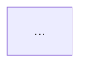

# explain: onboarding rules, Mermaid flows and the `onboard` rung

Date: 2026-10-16. Status: draft, builder check done 2026-10-16 (its four questions are settled in
section 14, items 9 to 12). The user skipped the brainstorming questions ("ok"), so every call in
this document is the author's; section 14 lists the ones to check. Coverage: not opted in.

## 1. Problem

The user, after the diadoc + esb course of 2026-10-14: the course and lesson rungs "oversimplify too
many flows". They asked for "onboarding rules for services, like exploring architecture, flows, and
so on, using text-like diagrams for visual representation, maybe mermaid".

Where the simplification happens today, read from that course run:

- The map of a source (`course/map-task.md`) is a flat list of facts in six sections. The esb map
  has 126 fact lines, among them the four preprocessor phases, the place routing, the legacy path,
  the XSLT and validator steps and the response strategy. No fact says what follows what. The
  orchestrator rebuilds the flow from the bag of facts and keeps the straight line: 20 hops of one
  sentence each, `classify, parse, route, bridge, deliver`. The branches that the map holds (the
  cross-place strategy, the legacy reply, the `To/@System` shortcut, the validator) are gone before
  the plan exists.
- A course follows one message. Every other flow of a service drops into one line of
  `not_covered` ("The template, cancel and partner requests of the service") with no evidence and
  no diagram. The user cannot see what was dropped.
- A lesson "holds one subsystem with two to four moving parts". Its first diagram is a hand-drawn
  SVG flow of boxes from left to right (`page.md` section 4). Every box costs layout work in
  `viewBox` units, so the author draws few boxes, and a condition becomes a sentence instead of a
  branch.
- Nothing mechanical finds an entry point that the map left out, a branch that the plan flattened,
  or a flow that no lesson and no `not_covered` line names.

## 2. Goals, non-goals, anti-goals

Goals:

- One written procedure, the onboarding rules, that tells a subagent how to explore one service:
  its shape, its architecture, every entry point, every flow with every branch, its state, formats,
  config, error paths and other systems. The procedure is the same whether a course maps a source
  or the user onboards to one service.
- The map that the procedure writes holds flows as Mermaid diagrams (text), with one cited fact per
  node. A branch in the code is a branch in the diagram.
- A mechanical floor: a script finds the entry points of a service by pattern, and the map must
  account for each one (traced, not traced with a reason, or dismissed with a reason). A script
  checks the map: sections, diagrams, node facts, cites and the inventory.
- Mermaid diagrams render to inline SVG in the explain pages, with the page palette, through the
  same headless Chrome that `verify.sh` uses. A reader never needs Mermaid in the browser. The
  SVG never passes through the author's context.
- The course plans from the flows: each hop names the flow it comes from, and each flow of each
  map is either on a hop or in `not_covered`, checked by `course.py check`.
- A lesson's first diagram is the flow of its hops as the map draws it, with every decision node.
- A new rung, `/explain <service-dir> --as onboard`, builds one page for one service from its map:
  the onboarding page.

Non-goals:

- No change to the lesson build (clips, gates, drop rules), the hub layout, the discovery script's
  search, or the video pipeline.
- No Mermaid in the browser at reading time. No CDN, no build step for the reader.
- No new review gate. `--review` has no effect on `onboard`.
- Sequence diagrams, class diagrams and the other Mermaid types are not checked and not required.
  Two types carry the rules: `flowchart` and `stateDiagram-v2`.
- No generated page from the map. The author writes the onboarding page from the page template, as
  every other rung does; the scripts render the diagrams into it and check it.

Anti-goals (a failure even if it runs):

- A map that lists facts and no flow. A flow diagram with a node that cites nothing.
- An entry point that the inventory found and the map does not mention.
- A course plan that drops a flow silently. Each dropped flow is named, by id, in `not_covered`.
- A lesson diagram with fewer branches than the map flow between the same two nodes.
- A page that needs the network, or an SVG with HTML labels (`foreignObject`), which the font
  guard and the PNG snapshots cannot read reliably.

## 3. Command

`/explain <service-dir> --as onboard`

- Only `--as onboard` selects the rung. It is never chosen from the content.
- The subject is one directory. A file, `this` or a topic is an error: print the rung line, say that
  the onboard rung takes one directory, offer `page`, stop.
- `--review` prints `--review: no effect on onboard` (the rule of `SKILL.md`, Contract, step 2).
- The language is `en` or `ru`, by the rule of the page rung.
- Rung line: `Rung: onboard (forced) — <reason> — subject: <path> (directory)`.

The course command does not change. Its map step follows the onboarding rules (section 10).

## 4. Output directory

`~/karpathy/out/YYYY-MM-DD-HHMMSS-onboard-<slug>/` (convention 5 of `SKILL.md`, rung `onboard`).

| Path | Holds |
|---|---|
| `map.md` | The onboarding map (section 6). The source of truth of the page. |
| `inventory.txt` | The entry points that `onboard.py inventory` found. |
| `diagrams/<id>.mmd` | One Mermaid diagram, copied verbatim from a fenced block of the map. |
| `diagrams/<id>.svg` | Its render, written by `mermaid_svg.py`. |
| `index.html` | The onboarding page, meta `<meta name="explain-rung" content="onboard">`. |
| `page.png`, `narrow.png`, `review/` | The snapshots, as for a page. |

A course keeps `map/<source-id>.md` as today, plus `map/<source-id>.inventory.txt`. A course
renders no map diagram; the lessons render the diagrams that they use (section 11).

## 5. The onboarding rules

`rungs/onboard.md` holds them, in a section "Explore the service" that `course/map-task.md` names
(as `lesson-task.md` names sections of `lesson.md`). The rules, in the order of the work:

1. Shape first. Read the build files, the main config and the entry of the process. Write one fact
   each for: the language and build tool, the runtime kind (web server, consumer, scheduler, batch,
   library), the deploy artifact (image, jar, binary, chart), and the purpose in one sentence.
2. Inventory. Run `onboard.py inventory <source-dir> --root <root>` (section 7). Read its lines.
   This is the list of entry points that the map must account for. The script finds patterns, not
   truth: a line can be a false hit, and a real entry point can be missing. Add the ones you find
   by reading. Dismiss a false hit with a reason.
3. Architecture. One `flowchart LR` of the parts at runtime: the components inside the service
   (listeners, controllers, services, repositories, clients, schedulers, by their real names), each
   store (table, cache, file system, queue the service owns), and each other system. Draw an edge
   for each call or message between them. One cited fact for each node. Keep it to the parts that a
   message meets; a utility class is not a part.
4. Flows. One flow for each entry point, or for each group of entry points that take the same
   path (name the group by the shared path; list each entry point under it). Trace the flow from
   its entry to each exit: a reply, a message sent, a row written, a log line and stop. Draw it as
   a `flowchart TD`. The rules of a flow:
   - A branch in the code is a branch in the diagram: each `if`, `when`, `switch`, strategy
     choice, `catch`, retry loop, timeout and feature flag on the path is a decision node with one
     edge for each outcome, labelled by the condition. An exit that is an error is a node.
   - Each node has one cited fact under the diagram (section 6). The cite of a decision node is
     its condition line. The cite of a call node is the call line.
   - A node that calls another system names the system and the handle (queue, endpoint, table).
   - At most 25 nodes in one diagram. A longer flow splits: the parent flow shows the stages as
     nodes, and each stage is a flow of its own with the id `<flow>-<stage>`.
   - Where a call enters a method that another flow already drew, draw one node that names that
     flow (`see <flow-id>`), not the nodes again.
5. State. The entities a message changes, and each status field with its transitions, as a
   `stateDiagram-v2`. One cited fact per state, from the line that sets it. `none found` when the
   service keeps no state.
6. Formats and transforms, routing config, error paths and other systems, as the course map asks
   today, as fact lines. The error paths section lists each retry, dead letter, timeout, error
   reply and compensation once more, as a list: the flows show where, the list shows what.
7. Not covered. Each directory or module of the source that you did not read, one line, with the
   reason. The map tells what it does not know.

Reading rules that stay from `map-task.md`: read the source only, change nothing, run no build and
no test, cite only a line read from disk, never copy a secret into a snippet, use CodeGraph first
when `.codegraph/` exists, `grep -rn` for a name.

Reading budget: the rules do not cap the lines read. They cap what leaves the map: an entry point
in the inventory that has no line in `Entry points` fails the check. A reason to not trace a flow
is one sentence that names the flow with the same shape ("the same path as `send`, with the
`cancel` type") or says why it is off any message path ("the admin health endpoint reads no
message").

## 6. The map

One Markdown file. The level-2 sections, in this order, all present (`none found` as the one line
of an empty section):

```
# Map: <id>

## Shape
- <fact> | <path>:<line> | <snippet>

## Architecture

- <node-id>: <fact> | <path>:<line> | <snippet>

## Entry points
- <kind> <name> -> <flow-id> | <path>:<line> | <snippet>
- <kind> <name> -> not traced: <reason> | <path>:<line> | <snippet>
- <kind> <name> -> not an entry point: <reason> | <path>:<line> | <snippet>

## Flows
### <flow-id>: <question>

- <node-id>: <fact> | <path>:<line> | <snippet>

## State

- <state>: <fact> | <path>:<line> | <snippet>

## Formats and transforms
## Routing config
## Error paths
## Other systems
- <system>: <handles> | <path>:<line> | <snippet>

## Not covered
- <directory or module>: <reason>
```

Rules of the format, which `onboard.py check` enforces:

- A fact line is `- <fact> | <path>:<line> | <snippet>`. `<path>` is relative to the root. The
  snippet has at most 12 words, copied verbatim from that line (the cite rules of convention 2).
  `Not covered` lines carry no cite.
- A node fact line starts with the node id and a colon: `- <id>: <fact> | ...`. Every node of the
  diagram above it has exactly one such line, and every such line names a node of that diagram.
- Ids: a flow id and a node id match `[a-z][a-z0-9_-]*`. Node ids are unique inside one diagram.
  A subgraph id is not a node.
- A diagram is one fenced block with the info string `mermaid`. The first line of the block is
  `flowchart TD`, `flowchart LR` or `stateDiagram-v2`. `Architecture` holds one `flowchart`.
  Each `### <flow-id>: <question>` under `Flows` holds one `flowchart`. `State` holds one
  `stateDiagram-v2` or the line `none found`. In a `stateDiagram-v2`, each state that is not
  `[*]` has one fact line, keyed by the state name.
- A flowchart has at most 25 nodes.
- `Architecture`, `Flows` and `State` may hold the one line `none found` when the source has no
  code to trace: a docs repository, a config repository. A docs source that documents a request
  sequence (an API guide with "send, then poll") draws it as a flow; its node cites point to the
  lines of the docs. The check accepts `none found` in these three sections and then applies no
  diagram rule to them.
- An `Entry points` line ends its fact part with `-> <flow-id>`, `-> not traced: <reason>` or
  `-> not an entry point: <reason>`. A named flow id exists under `Flows`. A reason is not empty.
- With `--inventory <file>`, every `<path>:<line>` of the inventory is the cite of one
  `Entry points` line.
- `Other systems` keeps the shape that `course_discover.py` reads: handles in backticks in the fact
  part. The section title does not change.

The map is for the orchestrator and the author, not for a reader. Its prose is not linted. Code
names stay in backticks.

## 7. `scripts/onboard.py`

Two commands. Each prints one line per finding and one summary line last.

`onboard.py inventory <source-dir> --root <root> [--out <file>]`: greps the source for entry-point
patterns and prints one line per hit, `<path>:<line>\t<kind>\t<text>`, path relative to
`<root>`, text the line with the white space squashed, at most 120 characters. Writes the same
lines to `--out`. Skips test trees (`src/test`, `test/`, `tests/`, `*_test.go`, `*Test.java`,
`*Test.kt`, `*Spec.kt`), `node_modules`, `target`, `build`, `.git`, `vendor`. Exits 0 with
`inventory: <n> entry points`, 2 on a missing directory.

The patterns, by kind (the script holds the table; the rung file lists the kinds):

| Kind | Patterns |
|---|---|
| `http` | `@GetMapping`, `@PostMapping`, `@PutMapping`, `@DeleteMapping`, `@PatchMapping`, `@RequestMapping` on a method, `@Path(` (JAX-RS), `@MessageMapping`, `@ServerEndpoint`; Go: a router call with a route string literal as its first argument, `\.(Get\|Post\|Put\|Delete\|Patch\|GET\|POST\|PUT\|DELETE\|PATCH\|Handle\|HandleFunc)\(\s*"`, and `http.HandleFunc(`. The literal anchor keeps a Go service from producing hundreds of hits that each need a dismissal line. |
| `listener` | `@JmsListener`, `@RabbitListener`, `@KafkaListener`, `@KafkaHandler`, `@SqsListener`, `@StreamListener`, `@ServiceActivator`, `@InboundChannelAdapter`, `@EventListener`, `@TransactionalEventListener`, `@ExternalTaskSubscription`, `implements JavaDelegate`, `: JavaDelegate`; Go: `.Consume(`, `NewReader(`, `NewConsumer(`, `Subscribe(` |
| `route` | Camel: `from(` inside a `RouteBuilder`, `- from:` and `uri:` under `from` in `*.camel.yaml`, `routeTemplate`; `@GrpcService`, `Register` + `Server(` (Go gRPC) |
| `schedule` | `@Scheduled`, `cron.`, `NewTicker(`, `time.Tick(` |
| `main` | `public static void main`, `fun main(`, `func main(` |

Languages: Java, Kotlin, Go, plus YAML and XML route files. Nothing else in this version; the table
is one dict and grows by a row.

`onboard.py check <map.md> --root <root> [--inventory <file>]`: checks section 6. One failure per
line, then `onboard: ok` or `onboard: <n> failures`. Exit 0, 1, or 2 for an unreadable map or
root. The prefix of a line tells where the fault is:

| Prefix | Meaning |
|---|---|
| `section: missing <title>` / `section: <title> out of order` | The level-2 skeleton. |
| `diagram <where>: none` / `diagram <where>: not flowchart or stateDiagram-v2` / `diagram <where>: <n> nodes, more than 25` | `<where>` is `architecture`, `state` or the flow id. |
| `node <where>/<id>: no fact line` / `fact <where>/<id>: not a node` / `fact <where>/<id>: two lines` | Node and fact lines. |
| `cite <section>#<n>: <problem>` | The problems of `cite_check`: path missing under root, line beyond the end, snippet not on that line, more than 12 words. Reuse `_cite_problems` of `course.py` (move it to `cite_check.py` if the import is awkward). |
| `entry #<n>: no flow id and no reason` / `entry #<n>: flow <id> not in Flows` | Entry lines. |
| `inventory <path>:<line>: not in Entry points` | Only with `--inventory`. |
| `map: cannot read` | Not a Markdown file with a `# Map:` title. Exit 2. |

The Mermaid parser is small and tolerant: it needs node ids and a count, not a full grammar.
Strip edge labels (`|...|`, `-- text -->`, `-. text .->`), split on arrows, and take the
`[a-z][a-z0-9_-]*` token at the start of each segment, before any shape bracket (`[`, `(`,
`{`, `>`), as a node id. `subgraph <id>` and `end` lines are not nodes. In a `stateDiagram-v2`,
a state is a token on either side of `-->` or after `state`, not `[*]`.

## 8. `scripts/mermaid_svg.py`

Renders Mermaid text to SVG in headless Chrome, with the Chrome handling of `verify.sh` (process
group, poll the dump for `</html>`, kill, sweep by the temp path).

```
mermaid_svg.py render <in.mmd> [<out.svg>]     one diagram; stdout when no out path
mermaid_svg.py inline <index.html>             every figure.mermaid of the page (section 9)
env EXPLAIN_MERMAID_JS   the bundle (default $HOME/karpathy/video-workspace/mermaid/mermaid-12.2.0.min.js)
env MERMAID_TIMEOUT      seconds to wait for Chrome (default 60)
exit 0 ok, 1 a render failed, 2 usage or Chrome not found
```

The bundle: `mermaid@12.2.0`, file `dist/mermaid.min.js`, 5 494 801 bytes, sha256
`a8a6a6f805b074a8261a2825c86f99c8054acb3b35f50bb7e24a4f9f2c3c3b9f`. When the file is missing,
the script prints `mermaid: download mermaid-12.2.0.min.js (5.5 MB)`, fetches
`https://unpkg.com/mermaid@12.2.0/dist/mermaid.min.js` (fallback
`https://cdn.jsdelivr.net/npm/mermaid@12.2.0/dist/mermaid.min.js`) to `<name>.<pid>.part`,
checks the hash, and moves it into place, by the fetch rules of `video-workspace.sh`. A wrong hash
is `mermaid: FAIL sha256 <got>`; the part file is removed. The file lives beside the video
workspace but needs none of it: no `npm ci`, no Remotion.

The render: one harness HTML in a temp dir, the bundle inlined in a `<script>`, then a script
that calls `mermaid.initialize(config)` and `mermaid.render(id, text)` for each diagram, puts the
SVG in `<div id="out-<n>">`, and sets `data-mermaid="OK"` or `FAIL <n>: <message>` on `<html>`.
Chrome runs with `--headless=new --disable-gpu --dump-dom --hide-scrollbars`. One Chrome run for
all the diagrams of a page. The spike of 2026-10-16 measured 1.0 s for a flow of 11 nodes.

The config is fixed in the script (no option): `theme: "base"`, `securityLevel: "strict"`,
`htmlLabels: false` at the top level and under `flowchart` (so every label is SVG text and the
SVG holds no `foreignObject`), `fontSize: "14px"` (the font floor of the page), and
`themeVariables` from the palette of `templates/page.html`: `fontFamily` the `--sans` stack,
`primaryColor #f0eee6`, `primaryTextColor #1f1d1a`, `primaryBorderColor #1f1d1a`,
`lineColor #1f1d1a`, `secondaryColor`, `tertiaryColor`, `background` and `edgeLabelBackground`
`#faf9f5`. A diagram id is the stem of its `.mmd` file, and the SVG element id is `mmd-<stem>`;
Mermaid scopes its `<style>` by that element id, so two diagrams on one page never share a rule,
and a rule never reaches a section of the page whose id equals the stem (`section#flow-auth`
beside `flow-auth.mmd`: the live run of 2026-10-17 lost its paragraph gaps to `#flow-auth p`
before the prefix existed).

What the script does to the SVG before it writes it: keeps `viewBox`; sets `width` and `height`
to the `viewBox` size rounded **up** to whole pixels, so the SVG keeps its intrinsic size and never
scales (the font guard of the page multiplies the font size by rendered width over `viewBox`
width; a width rounded down gave `SMALLTEXT:14` and failed, measured 2026-10-16; rounded up, both
viewports pass); removes the root `style="max-width: …"`; replaces Mermaid's
`role="graphics-document document"` with `role="img"`; adds `data-ste="skip"`,
`aria-labelledby="<id>-title"` and a `<title id="<id>-title">` with the text that `inline` takes
from the figcaption (for `render`, from `--title`, default the id).

Failure lines: `mermaid: FAIL <id> <message>` with Mermaid's parse message, `mermaid: FAIL Chrome
not found <path>`, `mermaid: FAIL timeout`. Last line on success: `mermaid: ok <n> diagrams`.

## 9. The Mermaid pattern of a page

`rungs/page.md` section 4 gets one more pattern, and `templates/page.html` one CSS rule.

```html
<figure class="mermaid" data-src="diagrams/<id>.mmd">
  <figcaption>One STE sentence: what this flow is.</figcaption>
</figure>
```

- Write the diagram text to `diagrams/<id>.mmd` in the output directory. Then run
  `python3 <skill-dir>/scripts/mermaid_svg.py inline index.html`. It renders each `.mmd` to
  `diagrams/<id>.svg` and writes the SVG as the first child of its figure, before the
  `figcaption`. A second run replaces the SVG. Never paste an SVG by hand.
- CSS, three rules: `figure.mermaid` takes the rules of `figure.bpmn` (breaks out of the column,
  `overflow-x: auto`), `figure.mermaid svg { display: block; max-width: none }`, and
  `figure.mermaid svg text { font-size: 14px }`. The third is needed because the template's
  `svg text { font-size: 18px }` wins over the size that Mermaid's labels inherit, as it did for
  BPMN (`svg.bpmn text`). The SVG keeps its intrinsic size at every viewport: a diagram wider
  than the column scrolls inside its figure, as a BPMN plane does. A `flowchart TD` of 11 nodes
  measured 496 px wide, so a TD flow usually fits the 500 px viewport with a small scroll; a
  `flowchart LR` scrolls. The 25-node cap is a reading cap, not a layout cap.
- When to use it: any flow with a branch, and any state machine. The hand-drawn flow pattern stays
  for a straight pipeline of at most six boxes. The sequence and layers patterns stay. A BPMN plane
  keeps its own pattern.
- The cites of the figure's section go in the `div.cites` after the lead paragraph or the
  figcaption, as for a diagram-only section today.
- The `media` check of `verify.sh` does not read `data-src`. An empty figure is a fault that
  `mermaid_svg.py inline` reports (exit 1 when a `data-src` file is missing) and that the tiles
  show.

### 9.1 The onboarding page

The author writes `index.html` from `templates/page.html` by the rules of `page.md` ("Fill the
template", "Provenance", "Write the prose", "Verify and export"), with this section plan in place
of "Plan the sections". The section count follows the flows, as it follows the planes of a BPMN
subject: never merge flows to get under twelve sections.

- Title: what the service does and why it exists, as a question. Answer box: the purpose, the
  runtime kind and the main flows by name, two to four sentences, from `Shape`.
- `#whole`, "What is <service> made of?": a lead paragraph, the architecture diagram
  (`diagrams/architecture.mmd`, the block of the map verbatim), then one paragraph for each other
  system and each store that the diagram shows.
- `#entry`, "Where does a message enter?": a table (`.table-wrap > table`) with one row per
  `Entry points` line of the map that is traced or not traced: kind, name, the flow as a link to
  its section, or "not traced" with the reason. Dismissed inventory lines stay in the map only.
- One section per flow, id `flow-<flow-id>`, `<h2>` the question of the flow: a lead paragraph
  (what comes in, what leaves), the flow diagram (`diagrams/flow-<flow-id>.mmd`, verbatim), then
  one paragraph for each decision node that names its branches and says why the branch exists,
  and one paragraph for each node that calls another system or writes a store. A node that says
  `see <flow-id>` gets one sentence with a link to that section.
- `#state`, "Which states does a message go through?": the state diagram and one paragraph per
  state. Omit the section when `State` is `none found`.
- `#formats`, `#config`, `#errors` and `#systems`: reference sections from the four fact sections
  of the map. Exact rules go into `details.walk`. `#errors` is a list: each retry, dead letter,
  timeout and error reply, with a link to the flow section where it happens. `#systems` is a table
  of system and handles.
- `#terms`: the glossary, by the page rule.
- `Not covered` in the footer: each `Not covered` line of the map, and each not-traced entry
  point with its reason.
- Every section holds at least one `<cite>` (a directory subject). The cites are the map lines,
  copied; `cite_check.py` verifies them again on the page.
- Provenance as for a directory subject: `data-kind="directory"`, `data-root` the repo root.
- No steps player is required. The line `<n> sections would gain from a clip` is not printed.

## 10. The course: map step

`course/map-task.md` becomes a short prompt that points at `rungs/onboard.md`: "Explore the
service" and "The map", with the course overrides (the ids, the root, the output path
`{course_dir}/map/{source_id}.md`, the inventory path `{course_dir}/map/{source_id}.inventory.txt`,
the language). The placeholders stay the set of today. The result line stays
`map: done {source_id} <n> facts` (`<n>` counts the fact lines, node lines included) or
`map: failed <reason>`.

The map subagent runs `onboard.py inventory` first and `onboard.py check --inventory` last, and
fixes the map until `onboard: ok`, by a stop rule of 3 rounds. If failures remain, it still ends
with `map: done` and lists the failure lines before it; the orchestrator prints them.

`rungs/course.md` "Map the sources": after the subagents return, the orchestrator runs
`onboard.py check <map> --root <root>` on each map and prints the failure lines. A map with
failures still counts as a map: it is an input, not the artifact. Only a map that the check cannot
read (`map: cannot read`) counts as `map: failed`. A map whose `Flows` is `none found` is a map:
a docs or config source has no flow to trace, and its facts still support hops.

Discovery does not change: `course_discover.py` reads `Other systems` as today.

## 11. The course: plan and lessons

`course.json` gets two fields on a hop. `"flow": "<source-id>/<flow-id>"` names the flow that the
hop comes from: required for a `code` hop, a string or `null` for a `docs` hop (a docs map can
have no flow), `null` for an `inferred` hop. The named flow is a `### <flow-id>:` heading under
`Flows` in `map/<source-id>.md`. `"nodes": ["<node-id>", …]` lists the nodes of that flow that
the hop covers, in flow order: non-empty when `flow` is a string, `[]` when it is `null`.

`from` and `to` of a hop do not change: they name systems, and the hub prints them in each box.
The binding of a hop to the flow is `nodes`, and it is checked.

`course.json` becomes version 2. `course.py` refuses a version 1 file with one line,
`course: version 1 is older than this skill; start a new course`, exit 2, from every command. A
course of `out/` is discardable output; nothing migrates it.

Planning rules added to "Plan the course":

- Read the `Flows` of each map. The flows that carry the message of the course give the hops. Walk
  the nodes of such a flow in their order. A node that changes the message, sends it, stores it, or
  replies is a hop, together with the nodes before it since the last hop. A decision node whose
  edge leads to an error exit gives a `branch` hop. A decision node that splits the main path gives
  one hop for each edge, and `what` names the condition.
- A flow that some hop names is a followed flow. Every node of a followed flow is in the `nodes`
  of one hop, or named in `not_covered` as `<source-id>/<flow-id>/<node-id>`. Thus a node leaves
  the course only by name.
- A flow of a map that no hop names gets one sentence in `not_covered` that holds
  `<source-id>/<flow-id>`. A sentence can name several flows or nodes.

Checks added to `course.py check` (the Mermaid parser of `onboard.py` reads the maps):

| Line | Meaning |
|---|---|
| `hop <id>: flow <source>/<flow> not in map/<source>.md` | The map has no such flow heading. |
| `hop <id>: flow missing` | A `code` hop with no flow. |
| `hop <id>: nodes empty` / `hop <id>: node <n> not in flow <source>/<flow>` | The node binding. |
| `flow <source>/<flow>: in no hop and not in not_covered` | The flow floor, for every flow of every map of a source of the course. |
| `node <source>/<flow>/<id>: in no hop and not in not_covered` | The node floor, for every node of a followed flow. |

`summary` prints the flow and the node count after the evidence of a hop:
`code, flow esb/request, 4 nodes`.

`course/lesson-task.md` gets one override under "Scope": the first diagram of the lesson uses the
Mermaid pattern of `page.md`. Its text is cut from the map block of the flow by the `nodes` of the
hops of the lesson: every line of the block whose node ids are all in that set, plus each edge
that leaves the set, with its far node kept as one node that names the lesson that covers it. The
cut is mechanical; nothing is redrawn. Each decision node of that diagram gets one paragraph that
names its branches, or its own section. The lesson still holds "two to four moving parts": a
moving part is a hop, not a node.

A rule for the plan: a lesson holds the hops of one flow, or of two flows that meet at one node.

## 12. `SKILL.md`, `verify.sh`, `README.md`

- `SKILL.md`: `onboard` in the argument-hint, the syntax line and step 4 of the Contract ("eight
  names"); a row in the rung table (forced only, "A service to onboard to: its architecture and
  every flow"); a bullet under the rung rules (English or Russian); a bullet under Rung files; the
  conventions sentence lists seven artifact rungs.
- `verify.sh`: `rung=onboard` renders the two page viewports; the usage message lists it. No new
  check line: the page keeps the page lines (six) and `bpmn` last.
- `scripts/bpmn.py`: `onboard` joins `RUNGS`, else `bpmn.py check --rung onboard` exits 2 and
  every onboard page fails with `bpmn: FAIL bpmn exit 2`.
- `README.md`: the `--as` list, one clause for the rung.

## 13. Files and tests

New: `rungs/onboard.md`, `scripts/onboard.py`, `scripts/mermaid_svg.py`,
`tests/test_onboard.py`, `tests/test_mermaid_svg.py`, test fixtures (a small map, a small Java and
Go tree for the inventory, a `.mmd` pair).

Changed: `SKILL.md`, `README.md`, `rungs/page.md`, `rungs/course.md`, `course/map-task.md`,
`course/lesson-task.md`, `templates/page.html`, `scripts/course.py`, `scripts/verify.sh`,
`scripts/bpmn.py` (`RUNGS`), `tests/test_course_prompts.py` (the section list of the map),
`tests/test_course.py` (the `flow` and `nodes` fields, the two floors), `tests/test_rung_drift.py`
(eight names, the new rung bullets, the section plan of 9.1), `tests/test_verify.py` (the onboard
rung renders two viewports), `tests/test_bpmn_check.py` (the rung list), `tests/test_page_template.py`
(the three `figure.mermaid` rules).

Tests that need Chrome (`mermaid_svg.py render`, `inline`, the onboard verify case) run in the
normal suite, as the `verify.sh` tests do today. They read the real bundle from
`EXPLAIN_MERMAID_JS` or its default path, and they skip with the message
`mermaid bundle missing: <path>` when it is absent; no test of the normal suite fetches the
network. The bundle is in place on this machine (2026-10-16, hash checked). The download path
of the script is tested by one gated test (`EXPLAIN_MERMAID_E2E=1`) that fetches into a temp
directory and checks the hash, and by one normal test that serves a wrong file from a local
path and expects `mermaid: FAIL sha256 <got>`.

Proof at the end: run `/explain <one real service> --as onboard` on a repo of the user (a qmd
collection such as `diadoc`), read the tiles, and compare the entry points of the map with the
inventory. Then resume nothing: the diadoc + esb course of 2026-10-14 is not rebuilt.

## 14. Calls made by the author (check these)

1. A new rung `onboard` exists, besides the course change. Reason: the rules need one owner, and a
   single service is the case the user names ("onboarding rules for services").
2. Mermaid is the notation in the map and in the pages, rendered to SVG at build time by headless
   Chrome; the reader's page holds the SVG only. Reason: convention 3 (offline, no CDN); the font
   guard and the PNG tiles read SVG text; the author draws a 25-node branching flow in text with no
   layout work, which is what removes the pressure to flatten.
3. The bundle is `mermaid@12.2.0`, fetched once by hash into the video workspace directory, not
   added to `video/package.json`. Reason: `npm ci` plus the browser download is 700 MB for one
   5.5 MB file, and the onboard rung must not need Remotion.
4. Two diagram types carry the checks: `flowchart` and `stateDiagram-v2`. Reason: node facts need a
   stable notion of a node.
5. The entry-point inventory covers Java, Kotlin and Go, plus Camel YAML. Reason: the user's
   stack (memory: JUnit XML and `go test -json`, no other ecosystems unless asked).
6. The map is not linted (it is for agents); the page is. The onboarding page is written by the
   author from the page template, not generated from the map. Reason: every rung works this way,
   and a generator is the one piece that this design can leave out.
7. The course hub does not render the maps' diagrams. Reason: scope. The flows that the course does
   not follow are named by id in `not_covered`; the maps stay on disk beside the hub.
8. A map with check failures is still an input to the course. Reason: dropping a whole source over
   one bad snippet loses more than it protects.

After the builder check (2026-10-16), four more:

9. The SVG keeps its intrinsic size, rounded up to whole pixels, and scrolls inside its figure;
   `figure.mermaid svg text` is 14 px. Reason: measured against the font guard of the template
   (section 8). A scaled SVG fails `render 500x844` with `SMALLTEXT`.
10. The onboarding page has a fixed section plan with one section per flow and no merging
    (section 9.1). Reason: merging flows into one section is the flattening that the user named.
11. A docs or config source writes `none found` under `Architecture`, `Flows` and `State`, and its
    facts still support `docs` hops; `flow` is required for `code` hops only. Reason: the
    diadoc + esb course had `kontur-docs` as a docs source cited by two hops.
12. A hop binds to its flow by `nodes`, checked against the map, and every node of a followed flow
    is on a hop or in `not_covered` by name. `from` and `to` stay system names. Reason: the hub
    prints `from → to`; a node-level floor is what makes "no branch dropped" checkable.
