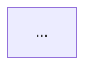

# sdr: a system design review skill

Date: 2026-10-20. Status: draft, builder check done 2026-10-20 (one question, settled as section 13 item 0; five minor gaps settled in sections 6 and 7.1). The user described the need, then handed the remaining calls to the
author ("do as you see fit … prepare spec, go ahead with planning, use ralph loop if more than 1
wave") and went offline. Every call that the user did not state is the author's; section 13 lists them.
Coverage: not opted in.

## 1. Problem

The user explores how to do some change A in a service B. The research takes days, and no one option
emerges as the clear choice. The user wants a skill that drives such a decision through fixed stages:
exploration, a brainstorming conversation, a consilium of reviewers, a result, and a review. The output
is a file that describes the problem, the requirements, the options with their pros and cons, and the
decision, plus a visual page in the style of the `explain` pages of this repository.

The user's words that set the scope:

- "not explain but similar to brainstorming": a new skill, not a rung of `explain`. It talks with the
  user, as `superpowers:brainstorming` does.
- "like a problem, functional reqs, non functional reqs, options to solve and so on".
- "exploration -> brainstorming -> consilium -> result -> review".
- "a file describing a problem, possible solutions, their pros and cons … with visual artifact in this
  repo style".
- "we should have reviews and searchers in this skill, since it's a requirement": subagents that search
  and subagents that review are part of every run, not an option.

The case that the user had in mind, used in this document as the running example and as the test case
of the first live run (section 12):

> An orchestration service receives government enquiries (claims) and turns them into warrants. Another
> service blocks, unblocks and confiscates money and publishes an event for each action. Most source
> systems map one claim to one warrant, and the claim changes over time. One source system maps many
> claims to one warrant: `A: BLOCK 50`, `A: SET ALLOWANCE 20`, `B: BLOCK 100`, `B: CONFISCATE 20`. The
> user must notify the end user about the actions. The legacy flow ran workflows per claim; the new
> system is warrant-based, and a warrant holds the total of all its claims. How to notify properly?

The author's reading, which the user did not correct: the execution events carry the warrant total, so
the information "which claim caused this action" is lost before a notifier sees it. The real decision is
at which grain notifications live (claim, warrant or action) and where the claim attribution survives.

## 2. Goals, non-goals, anti-goals

Goals:

- `/sdr` runs one design review from a question to a checked decision record and a page.
- Exploration is done by fresh subagents (searchers): one for each code directory that the user names,
  and one to three for the web. Each searcher writes cited facts to a file.
- The requirements come from a conversation with the user, one question at a time, in the manner of
  `superpowers:brainstorming`, informed by what the searchers found. Each requirement has an id and a
  source: the user, a cited code fact, or an assumption that the user must confirm.
- At least three distinct options, one of them the smallest change that could work. Each option has a
  flow diagram, its changes by service, pros, cons, risks, effort, reversibility, and a fit mark for each
  requirement.
- A consilium: three fresh reviewer subagents with fixed roles judge the options against the
  requirements, in parallel, without the author's context.
- A decision that names one option, why, why not each other option, the dissent of the consilium, and
  the conditions that would reopen it.
- A cold review of the finished page by a fresh subagent, with rounds, as gate 1 of the lesson rung does.
- One record file, `sdr.md`, that is the source of truth, and one page, `index.html`, built from it with
  the `explain` page template and checks.
- A mechanical floor: `sdr.py check` validates the record for the stage it is at; `sdr.py matrix`
  writes the comparison table of the page from the record, so the page and the record cannot drift.
- A run can stop and resume: rerun `/sdr <sdr-dir>`.

Non-goals:

- No change to the `explain` skill, its rungs or its scripts, except what the reuse needs (none
  planned; section 9).
- No full onboarding map of each service. A searcher maps only what the question touches. The user can
  run `/explain <dir> --as onboard` for a full map.
- No implementation plan for the chosen option. The record ends at "next steps".
- No ADR template of another tool (MADR, Nygard). The record format is this skill's.
- No new flag beyond the subject. No "skip the review" or "skip the search" mode.

Anti-goals (a failure even if it runs):

- A recommendation that the comparison matrix does not support: the chosen option fails a requirement
  that another option meets, and the decision does not say why that is acceptable.
- A strawman: an option written to lose (no pros, or a con that the cited facts contradict).
- A requirement with no source, or an assumption presented as a fact.
- A consilium preference that differs from the decision and is not shown on the page.
- A claim about the user's code that cites nothing.
- A run that stops for the user more than twice before the handoff.

## 3. Command

`/sdr <question> [<code-dir> ...]` or `/sdr <sdr-dir>`.

- The skill is user-invoked only (`disable-model-invocation: true`), like `explain` and `ste`.
- Each argument word that is an existing directory (after `~` expansion) is a code directory. The rest,
  joined with spaces, is the question.
- One argument that is a directory holding `sdr.md` resumes that run (section 5). It is never a code
  directory.
- An empty question with no resume directory: ask the user for the question, as the first message of
  the conversation. No usage error: the skill is a conversation.
- No code directory: ask once whether the question is about code, and where it lives. "None" is a valid
  answer; the run then has web searchers only.
- `--review`, `--as` and other flags do not exist. A word that starts with `--` is an error that lists
  the two forms above.

## 4. Output directory

`~/karpathy/out/YYYY-MM-DD-HHMMSS-sdr-<slug>/`, by convention 5 of the `explain` skill (the slug from
the question). `out/` is gitignored.

| Path | Holds |
|---|---|
| `sdr.md` | The record (section 6). The source of truth of the page. |
| `explore/code-<id>.md` | The facts of one code searcher (section 7.1). `<id>` is the slug of the directory basename. |
| `explore/web-<n>.md` | The facts of one web searcher (section 7.2). |
| `consilium/<role>.md` | The report of one consilium reviewer (section 7.4). |
| `review/review-round-<k>.md` | The report of the cold reviewer, round `k` (section 7.6). |
| `diagrams/<id>.mmd`, `.svg` | Mermaid diagrams, copied verbatim from `sdr.md`, rendered by `explain`'s `mermaid_svg.py`. |
| `index.html` | The page (section 8). |
| `page.png`, `narrow.png`, `review/*.png` | The snapshots, as for an `explain` page. |

## 5. Stages

The record holds its stage on the line after the title: `stage: <name>`. Each stage ends by writing the
next stage name and running `sdr.py check`. A resume reads the stage and continues with the next one.
The stages, in order:

| Stage | Who | What | Ends with |
|---|---|---|---|
| `intake` | author + user | Settle the question and the code directories. Make the output directory and the record skeleton. | `stage: intake` |
| `explore` | searchers | Start the code searchers and the web searchers in parallel (section 7). Wait for all. Run `sdr.py check` on each fact file. | `stage: explore` |
| `frame` | author + user | Play back the problem with the facts. Ask the user one question at a time until the requirements are settled. Write `Problem`, `Context`, requirements, constraints, non-goals, assumptions, and a shortlist of option names. **Stop 1**: the user approves the framing, or corrects it. | `stage: frame` |
| `options` | author | Write each option in full (section 6). | `stage: options` |
| `consilium` | 3 reviewers | Start the three reviewers in parallel (section 7.4). Wait for all. Copy each verdict into the record. Apply the fit corrections that the evidence supports; record each rejected correction with the reason. | `stage: consilium` |
| `decide` | author | Write `Decision`, `Open questions`, `Not covered`. | `stage: decide` |
| `page` | author | Write `index.html` (section 8); run the checks until clean. | `stage: page` |
| `review` | cold reviewer | Rounds of cold review (section 7.6). Fix, or record the dispute. | `stage: review` |
| `done` | author | Handoff (section 10). **Stop 2**. | `stage: done` |

The frame stage is the brainstorming part. Its rules, taken from `superpowers:brainstorming` and fitted
to a design review:

- One question per message. Open questions first ("walk me through the last time a user got a wrong
  notification"). A guess that the user can correct beats a question.
- Play back each part (problem, then functional requirements, then non-functional requirements) in a
  short chunk, and ask what is wrong or missing. Mark each guess as a guess.
- The territory to cover, never read out as a list: who the users of the change are and what they see;
  what happens today, with the searchers' facts; the functional requirements; the non-functional
  requirements (volume and latency, ordering and consistency, duplicates and idempotency, failure and
  recovery, audit and compliance, security and personal data, observability, migration and coexistence
  with the legacy flow, cost and effort); constraints that the user cannot change; non-goals; options
  that the user has already considered or rejected, and why.
- A non-functional requirement has a measurable target, or it says `target: unknown` and the target
  becomes an open question.
- When the user says "just guess" or "you decide", the author writes the requirement with the source
  `assumption` and goes on.
- Stop 1 shows the requirements, the assumptions and the option shortlist in chat, and asks for
  approval. The user can add an option or reject one. "go" approves.

## 6. The record: `sdr.md`

One Markdown file. The level-2 sections, in this order. A section that the stage has not reached holds
the one line `pending`. An empty section that the stage has reached holds `none`.

```
# SDR: <question>
stage: <stage>
root: <absolute root>
code: <absolute code dir>; <absolute code dir>   (or `none`)

## Problem
<one to three short paragraphs>

## Context
- <fact> | <path>:<line> | <snippet>
- <fact> | <url> | <snippet>

## Functional requirements
- FR-1: <requirement> | source: user
- FR-2: <requirement> | source: code | <path>:<line> | <snippet>
- FR-3: <requirement> | source: assumption
- FR-4: <requirement> | source: consilium <role>

## Non-functional requirements
- NFR-1: <requirement> | target: <measurable target or unknown> | source: <as above>

## Constraints
- <constraint> | source: <as above>

## Non-goals
- <non-goal>

## Options
### opt-a: <name>
<one paragraph: how it works>

- changes: <service>: <change>; <service>: <change>
- pros: <pro>; <pro>
- cons: <con>; <con>
- risks: <risk>; <risk>
- effort: S|M|L — <reason>
- reversibility: easy|hard — <reason>
- fit FR-1: meets|partial|fails — <reason>
- fit NFR-1: meets|partial|fails — <reason>

## Consilium
### architect
- preferred: opt-<x>
- verdict: <one sentence>
- correction opt-<x> FR-<n>: <old> -> <new> — accepted|rejected: <reason>

## Decision
- choice: opt-<x>
- why: <reason, by requirement ids>
- why not opt-<y>: <reason>
- dissent: <role> preferred opt-<y>: <their reason>; <why the decision stands>
- revisit when: <condition>
- next steps: <step>; <step>

## Open questions
- <question>

## Not covered
- <topic>: <reason>
```

Rules, which `sdr.py check` enforces for the sections that the stage has reached:

- `stage:` is one of the nine names of section 5, on line 2. `root:` on line 3 and `code:` on line 4
  are written by `skeleton` and read on a resume; `check` uses `root:` when `--root` is absent.
- At stage `frame`, `Options` holds the shortlist: at least three `### opt-<letter>: <name>` headers,
  each with the one line `pending`. From stage `options` on, each holds the full block.
- An assumption that the user confirms at Stop 1 changes its source to `user`. A requirement that
  keeps `source: assumption` is listed on the page under "To confirm" and at the handoff.
- From stage `page` on, `check` also compares the `div.sdr-matrix` block of `index.html` with what
  `matrix` would write, and reports `page: matrix stale` when they differ.
- A cite is `<path>:<line> | <snippet>` or `<url> | <snippet>`. A path cite is checked under the
  root (section 9) with the cite rules of `explain` (path exists, line exists, snippet on that line, at
  most 12 words). A URL cite is checked for form only.
- Requirement ids are `FR-<n>` and `NFR-<n>`, unique, numbered from 1 without gaps. Each has a
  `source:` of `user`, `code` (then a cite), `web` (then a URL cite), `assumption`, or
  `consilium <role>`. Each NFR has a `target:`.
- `Options` holds at least three `### opt-<letter>: <name>` blocks. Each holds one Mermaid
  `flowchart` (the parser and the 25-node cap of `onboard.py`), and the keys `changes`, `pros`, `cons`,
  `risks`, `effort`, `reversibility`, each once, each not empty. `pros` and `cons` each hold at least
  one item. Each holds exactly one `fit <id>:` line for each requirement id, with `meets`, `partial` or
  `fails` and a reason.
- `Consilium` holds the three roles `architect`, `operator`, `sceptic`, in that order. Each has
  `preferred:` naming an option id and a `verdict:`. A `correction` line names an option, a
  requirement, two marks and `accepted` or `rejected` with a reason. An accepted correction matches
  the `fit` line of that option now.
- `Decision`: `choice:` names an option. One `why not opt-<y>:` for each other option. One `dissent:`
  for each role whose `preferred` differs from the choice. At least one `revisit when:`. When the chosen
  option has a `fails` mark that another option `meets`, `why:` names that requirement id.
- The fact files of the searchers (section 7) use the `Context` line form and are checked with
  `sdr.py check-facts <file> --root <root>`.

The record is for the user and the author. Its prose is not linted. Code names are in backticks.

## 7. The subagents

Every subagent is a fresh general-purpose subagent, never a fork: a fork has the author's context and
its blind spots. In OpenCode, the `task` tool with the `general` agent. Each prompt is a template file
under `skills/sdr/prompts/`, filled by plain text replacement of the names in braces, as the lesson
gates do. Each subagent writes one file and changes nothing else. Searchers start in parallel; the
three consilium reviewers start in parallel.

### 7.1 Code searcher — `prompts/search-code.md`

One for each code directory. Inputs: the question, the directory, the root, the output path. It reads
the code with the reading rules of `explain`'s "Explore the service" (`rungs/onboard.md`): read only,
CodeGraph first when `.codegraph/` exists, cite only lines read from disk, no secret in a snippet. It
does not write an onboarding map. It writes `explore/code-<id>.md`:

```
# Facts: <id>
## Shape
- <fact> | <cite>
## Relevant flows
### <flow-id>: <question>
```mermaid
flowchart TD
```
- <node-id>: <fact> | <cite>
## Facts
- <fact> | <cite>
## Unknowns
- <what it could not find>
```

What it looks for: the current path of the thing the question names, where its data lives, the events
and messages on that path with their payloads, the places where information the question needs is
present or lost, and constraints visible in code (transactions, ordering, idempotency keys, retries).
It runs `sdr.py check-facts` until clean, at most three rounds. `check-facts` requires the title and
the `Facts` and `Unknowns` sections; `Shape` and `Relevant flows` are optional (a web fact file has
neither). A flow keeps the node rules of `onboard.py` (one fact line per node, at most 25 nodes).

### 7.2 Web searcher — `prompts/search-web.md`

One to three, each with one topic that the author picks from the question: prior art (how others solve
the same shape of problem), the named patterns that apply (for the example: notification per aggregate
or per command, event-carried state transfer, the outbox, correlation ids), and library or platform
documentation the options would depend on. It reads pages with the web tools, and writes
`explore/web-<n>.md` in the same format, with URL cites whose snippet is copied from the fetched page,
at most 12 words. No page it did not fetch.

### 7.3 Author

The main session. It runs intake, frame, options, decide, page and the fixes. It reads the fact files,
never the raw code dumps of the searchers.

### 7.4 Consilium — `prompts/consilium.md`

Three reviewers, one prompt, filled with `{role}` and the role brief:

| Role | Brief |
|---|---|
| `architect` | Fit with the existing architecture and its ownership boundaries: which service owns which fact, coupling, how each option evolves when the next source system arrives. |
| `operator` | What breaks at run time: ordering, duplicates, retries, replay, partial failure, back-pressure, migration from the legacy flow, how an operator sees and fixes a stuck case. |
| `sceptic` | Attack the leading option and the frame: a requirement that is wrong or missing, an option written to lose, a cheaper option that nobody wrote, an assumption that carries the decision. |

Inputs: `sdr.md` at stage `options` and the fact files. The reviewer may read the code under the root
and fetch web pages to back a finding. It writes `consilium/<role>.md`: for each option, a verdict;
each fit mark it disputes, with the evidence (a cite or a requirement id); each missing requirement,
with the evidence; its preferred option and why; the last line `preferred: opt-<x>`. A finding without
evidence is not a finding. The author copies each report into `Consilium` (section 6). A missing
requirement that the author accepts is added with `source: consilium <role>`, and each option gets a
fit line for it.

### 7.5 No other subagents

The author writes the options and the decision. A subagent that writes options would need the whole
conversation of the frame stage.

### 7.6 Cold reviewer — `prompts/review.md`

Adapted from `explain/lesson/review-page.md`. Inputs: `index.html`, `sdr.md`, the fact files and the
root. It hunts for: a sentence that its cites do not support; a page claim that the record does not
hold; a recommendation that the matrix does not support (the anti-goal of section 2); a strawman; a
dissent that the page hides. The same round rules as gate 1 of the lesson: round 1 hunts; round 2
rules each finding `resolved` or `open` against the author's `## Author` block, then hunts; a finding
first made in round 2 and fixed gets one verification read (round 3). Last line `verdict: ok` or
`verdict: fix`. At most three rounds. The author never overrules an open finding alone: it lists it at
the handoff.

## 8. The page

The author writes `index.html` from `skills/explain/templates/page.html` by the rules of
`explain/rungs/page.md` sections 3 to 7 (fill the template, diagram patterns, provenance, prose,
verify and export), with the section plan below in place of page.md section 2. The page keeps
`<meta name="explain-rung" content="page">`, so `verify.sh` checks it as a page with no change. The
prose follows the STE profile (`skills/ste/SKILL.md`), as on every `explain` page; English, or Russian
when the user asks, by convention 7 of `explain`.

- `<h1>`: the question. Answer box: the choice and its two strongest reasons, by requirement, at most 70
  words.
- `#why` "Why does this need a decision?": the problem, and one Mermaid diagram of the current state
  with the gap marked (a node with the class `gap`, defined by `classDef gap` in the diagram). Cites
  from the fact files.
- `#requirements` "What must the solution do?": two tables, functional and non-functional (id,
  requirement, target, source), then constraints, non-goals, and assumptions in a list headed "To
  confirm".
- `#compare` "How do the options compare?": one sentence that explains the marks, then the matrix.
  `sdr.py matrix` writes it (section 9): a row per requirement, a column per option, the chosen
  column marked. Cover the prose: the matrix alone must support the answer box.
- One section per option, id `opt-<x>`, `<h2>` its name as a question ("What if the warrant service
  emits one event per claim action?"): the lead paragraph, the option's diagram, changes, pros, cons,
  risks, effort and reversibility, and a `details.walk` "Fit by requirement" with each reason.
- `#consilium` "What did the reviewers say?": a table of role, preferred option and verdict, then one
  paragraph per role with its strongest argument. A dissent gets its own paragraph.
- `#decision` "What do we choose, and when do we revisit it?": the choice, why, why not each other
  option, revisit conditions, next steps, open questions.
- `#terms`: the glossary, by the page rule.
- Footer provenance: `data-kind="topic"`, `data-root` the root (section 9), and one Commit and Dirty
  value for each code directory. `Not covered` from the record.

The `div.cites` rule of `explain` holds: each paragraph's cites in one block, hidden until the reader
turns on Sources.

## 9. Scripts and files

```
skills/sdr/
  SKILL.md                  the procedure (sections 3 to 8, 10)
  prompts/search-code.md    7.1
  prompts/search-web.md     7.2
  prompts/consilium.md      7.4
  prompts/review.md         7.6
  scripts/sdr.py            check, check-facts, matrix, skeleton
  tests/                    unittest, as skills/explain/tests
```

`sdr.py` imports `fact_problems` from `skills/explain/scripts/cite_check.py` and the Mermaid node
parser from `onboard.py`, by path relative to its own directory resolved through symlinks, as the
`explain` scripts do. It needs only `python3` (stdlib).

```
sdr.py skeleton <sdr-dir> --question <text> --root <root> [--code <dir>]...
                                                write sdr.md at stage intake; refuse to overwrite
sdr.py check <sdr-dir> [--root <root>]          check sdr.md for its stage (section 6)
sdr.py check-facts <file> --root <root>         check one fact file (section 7.1)
sdr.py matrix <sdr-dir>                         write the matrix into index.html (below)
exit 0 ok, 1 findings, 2 usage or unreadable file
```

Output lines follow `onboard.py`: one finding per line with a prefix that says where
(`section:`, `req FR-2:`, `option opt-b:`, `fit opt-b/NFR-1:`, `consilium sceptic:`, `decision:`,
`cite <section>#<n>:`), then `sdr: ok` or `sdr: <n> findings`.

`sdr.py matrix` finds `<div class="sdr-matrix"></div>` in `index.html` and replaces its content with
`.table-wrap > table.matrix` (the CSS of the onboard events matrix in the page template): one header
cell per option (the chosen one with `class="chosen"` and the word "chosen"), one row per requirement
(id and the short text), and each cell a mark with an `aria-label` (`meets`, `partial`, `fails`) and
the visible symbols `✓`, `◐`, `✗`. A second run replaces the table. The generated block also holds
one `<style>` element with the rules for `.chosen` (a fill of the page's code colour and a bold
header), so the author adds no CSS and `explain`'s template does not change. If a check of `verify.sh`
rejects a `<style>` in the body, the plan moves the rule into the page's `<style>` by the copy step.

The root: the deepest common ancestor directory of the code directories, as `explain`'s course rung
finds it; the current directory when there is none. It is the `data-root` of the page, and each cite
path is relative to it.

`install.sh` links every `skills/*/` that holds a `SKILL.md`, so `skills/sdr` installs with no change.
`README.md` gets a third skill entry.

## 10. Handoff

Stop 2. Print the path of the output directory and run `open index.html` (never inside a subagent).
Then list, in chat, in this order: the choice in one sentence; each assumption still marked `To
confirm`; each requirement the consilium added; each open review finding; each open question. Nothing
else.

## 11. Testing

- The suite runs as `explain`'s does: `cd skills/sdr && python3 -B -m unittest discover -s tests`.
- `sdr.py`: unit tests for each check rule of section 6 and section 7.1, on fixture records under
  `tests/fixtures/`, one fixture per finding prefix, plus one valid record at each stage. The matrix:
  a fixture page before and after, a second run that changes nothing, and the chosen column.
- Prompts: a test, as `test_lesson_prompts.py`, that each prompt names only the braces that
  `SKILL.md` says the author fills, and that `SKILL.md` names each prompt file that exists.
- `SKILL.md` and the four prompts are written in STE, as `explain`'s skill files are:
  `python3 skills/ste/scripts/ste_lint.py <file>` prints `0 errors` for each.
- No end-to-end test with live subagents in the suite: a live run costs subagent tokens and needs the
  network.

## 12. Acceptance

One live run on the example of section 1, with a synthetic two-service fixture (an orchestrator that
maps claims to a warrant, and an executor that publishes warrant-total events) under
`skills/sdr/tests/fixtures/warrants/`, because the user's real repositories are not known to this
document. The run passes when `sdr.py check` prints `sdr: ok` at stage `done`, `verify.sh` passes the
page, the review ends `verdict: ok` or lists its open findings at the handoff, and the page opens with
the answer box, the `#why` diagram and the matrix on the first screens. The user then runs `/sdr` on
the real services.

## 13. Calls the author made (check these)

0. The acceptance run of section 12 is not a ralph wave: its frame stage needs the user. It runs
   interactively after the ralph waves close, with the user, and gates the finish of the feature.
1. A new skill `skills/sdr`, not an `explain` rung, from "not explain but similar to brainstorming".
   It reuses the `explain` template and scripts by path.
2. Two stops only: after the frame, and at the handoff. The options, the consilium, the decision and
   the review run without a stop.
3. Three fixed consilium roles (architect, operator, sceptic), after the user's earlier consilium of
   three with a sceptic.
4. Reviews always on, from "it's a requirement". A run costs about three searcher runs, three
   consilium runs and one to three review runs of subagent tokens.
5. The page is STE prose and passes `verify.sh`, as every page of this repo. The record is not linted.
6. The chosen column is styled by a `<style>` inside the generated matrix block, not by a change to
   `explain`'s template.
7. Output under `~/karpathy/out/`, gitignored. A record worth keeping is copied out by the user.
8. Searchers map only what the question touches, not a full onboarding map.
9. The acceptance run uses a synthetic fixture, not the user's real services.
