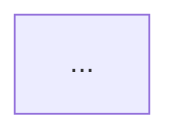

# Rung: onboard
This file holds only what is specific to the onboard rung. `SKILL.md` has the generic rules.

## 1. When an onboarding page

The onboard rung builds an onboarding page: one page that explains one service to a new member of its
team. The page shows the parts of the service, each entry point and the path of each message from its
entry to each exit. Each branch in the code is a branch in a diagram, and each node of a diagram has a
cite.

The onboard rung is a forced rung. Only `--as onboard` selects it. Never choose it from the content.
The command is `/explain <service-dir> --as onboard`.

The build has two parts. First, write a map of the service ("Explore the service" and "The map"). Then
write the page from the map. The map is the source of truth of the page.

The subject is one directory: the directory of the service. If the subject is a file, `this` or a
topic, print the rung line. Say that the onboard rung takes one directory. Stop. Offer `page`.

The onboard rung has no review. If the review is on, print `--review: no effect on onboard` after the
rung line, and continue.

The onboard rung is English or Russian, by the rule of the page rung. Write the page in `en`, or in `ru`
when the user asks for Russian. If the user asks for another language, print the rung line. Say that
the onboard rung is English or Russian. Stop. Offer `page`.

Print this line before you build, as `SKILL.md` says:

```
Rung: onboard (forced) — <reason> — subject: <path> (directory)
```

The `<reason>` names `--as onboard` and tells if the content fits the rung.

Find `<root>` before you explore. Run `git rev-parse --show-toplevel` in the service directory. Its
output is `<root>`. If the command fails, `<root>` is the absolute path of the service directory.
`<root>` is the `--root` of both `onboard.py` commands and the `data-root` of the page. Each cite path
is relative to `<root>`.

Make the output directory ("Output directory") before you explore. Run the two `onboard.py` commands in
the output directory. Make `<service-dir>` an absolute path, because the commands run in the output
directory.

## 2. Explore the service

In this file, `onboard.py <command>` is short for `python3 <skill-dir>/scripts/onboard.py <command>`.

Follow these seven rules, in the order of the work. Write each fact into `map.md`, in the format of
"The map".

1. Shape first. Read the build files, the main config and the entry of the process. Write one fact
   for each of these:
   - the language and the build tool;
   - the runtime kind: web server, consumer, scheduler, batch or library;
   - the deploy artifact: image, jar, binary or chart;
   - the purpose of the service, in one sentence.
2. Inventory. Run `onboard.py inventory <service-dir> --root <root> --out inventory.txt`. It prints
   one line for each hit: `<path>:<line>`, a tab, the kind, a tab and the text of the line. It writes
   the same lines to `inventory.txt`. The last line of its output is `inventory: <n> entry points`.
   Read each line. The map must account for each entry point of this list. The script finds patterns,
   not truth. A hit can be false, and the list can miss a real entry point. Add each entry point that
   you find when you read the code. Dismiss a false hit with a reason, as a
   `-> not an entry point: <reason>` line.
3. Architecture. Draw one `flowchart LR` of the parts at runtime. A part is a component inside the
   service, a store or another system. The components are the listeners, controllers, services,
   repositories, clients and schedulers, by their real names. A store is a table, a cache, a file
   system or a queue that the service owns. Draw an edge for each call or message between two
   parts. Write one cited fact for each node. Keep to the parts that a message meets. A utility class
   is not a part.
4. Flows. Write one flow for each entry point, or for each group of entry points that take the same
   path. Name a group by the shared path, and list each entry point under it. Trace the flow from
   its entry to each exit. An exit is a reply, a message sent, a row written, or a log line and stop.
   Draw the flow as a `flowchart TD`. These rules apply to each flow:
   - A branch in the code is a branch in the diagram. Each `if`, `when`, `switch`, strategy choice,
     `catch`, retry loop, timeout and feature flag on the path is a decision node. A decision node
     has one edge for each outcome, with the condition as its label. An exit that is an error is a
     node.
   - Each node has one cited fact under the diagram. The cite of a decision node is its condition
     line. The cite of a call node is the call line.
   - A node that calls another system names the system and the handle: a queue, an endpoint or a
     table.
   - Put at most 25 nodes in one diagram. A longer flow splits into stages. The parent flow shows
     each stage as one node. Each stage is a flow of its own, with the id `<flow>-<stage>`.
   - A call can enter a method that another flow drew already. Then draw one node that names that
     flow (`see <flow-id>`). Do not draw the nodes again.
5. State. Find the entities that a message changes, and each status field with its transitions. Draw
   them as one `stateDiagram-v2`. Write one cited fact for each state, from the line that sets it. If
   the service keeps no state, write `none found`.
6. Formats and transforms, routing config, error paths and other systems. Write them as fact lines,
   each in its section of the map:
   - `Formats and transforms`: the format of each message, and each change to its format or its
     content. Examples are XML, JSON, a message class, a mapper and an XSLT file.
   - `Routing config`: the config that decides where a message goes, with the file and the key.
     Examples are queue names, URLs, route rules and feature flags.
   - `Error paths`: each retry, dead letter, timeout, error reply and compensation, once more, as a
     list. The flows show where, and the list shows what.
   - `Other systems`: each other system that the service sends to or receives from. Give its name,
     then its handles in backticks. Examples are queue names, endpoints, artifact ids and host names.
7. Not covered. Write one line for each directory or module of the service that you did not read, with
   the reason. Thus the map tells what it does not know.

These reading rules apply to each step:

- Read the source only. Change no file of the source.
- Run no build, no test, no install and no git command that changes the repository.
- Cite only a line that you read from the disk.
- Never copy a password, a token or a key into a snippet or a fact. End the snippet before it, or cite
  a line near it.
- If `.codegraph/` exists in the service, use CodeGraph first. Use `grep -rn` to find a name in the
  files.

The rules do not limit the lines that you read. They limit what leaves the map. An entry point of the
inventory without a line in `Entry points` fails the check. A reason to not trace a flow is one
sentence. It names the flow with the same shape ("the same path as `send`, with the `cancel` type").
Or it says why the entry point is off any message path ("the admin health endpoint reads no message").

`onboard.py inventory` finds entry points of five kinds. It reads Java, Kotlin and Go files, and the
YAML and XML files of Camel routes. It skips test trees, `node_modules`, `target`, `build`, `.git` and
`vendor`.

| Kind | Finds |
|---|---|
| `http` | The Spring annotations `@GetMapping`, `@PostMapping`, `@PutMapping`, `@DeleteMapping`, `@PatchMapping` and `@RequestMapping` on a method, the JAX-RS `@Path`, `@MessageMapping` and `@ServerEndpoint`. In Go, a router call whose first argument is a route string, and `http.HandleFunc`. |
| `listener` | The annotations `@JmsListener`, `@RabbitListener`, `@KafkaListener`, `@KafkaHandler`, `@SqsListener`, `@StreamListener`, `@ServiceActivator`, `@InboundChannelAdapter`, `@EventListener`, `@TransactionalEventListener` and `@ExternalTaskSubscription`, and a class that implements `JavaDelegate`. In Go, the calls `Consume`, `NewReader`, `NewConsumer` and `Subscribe`. |
| `route` | A Camel `from(` in a `RouteBuilder` file, a `- from:` line of a `*.camel.yaml` or `*.camel.yml` file, a `<from uri=…>` element of an XML file, a `routeTemplate` and a `@GrpcService`. In Go, a gRPC call `Register<Service>Server(`. |
| `schedule` | A `@Scheduled` method. In Go, a `cron.` call, `NewTicker` and `time.Tick`. |
| `main` | `public static void main` in Java, `fun main(` in Kotlin and `func main(` in Go. |

## 3. The map

Write the map to `map.md`. It has this skeleton. Keep the ten level-2 sections,
in this order, with these titles. Write `none found` as the one line of an empty section.

````
# Map: <id>

## Shape
- <fact> | <path>:<line> | <snippet>

## Architecture

- <node-id>: <fact> | <path>:<line> | <snippet>

## Entry points
- <kind> <name> -> <flow-id> | <path>:<line> | <snippet>
- <kind> <name> -> not traced: <reason> | <path>:<line> | <snippet>
- <kind> <name> -> not an entry point: <reason> | <path>:<line> | <snippet>

## Flows
### <flow-id>: <question>

- <node-id>: <fact> | <path>:<line> | <snippet>

## State

- <state>: <fact> | <path>:<line> | <snippet>

## Formats and transforms
## Routing config
## Error paths
## Other systems
- <system>: <handles> | <path>:<line> | <snippet>

## Not covered
- <directory or module>: <reason>
````

`<id>` in `# Map: <id>` is the name of the service directory, the last segment of its path. These rules
give the format:

- A fact line is `- <fact> | <path>:<line> | <snippet>`. `<path>` is relative to `<root>`. The snippet
  has at most 12 words, copied verbatim from that line (the cite rules of convention 2 of `SKILL.md`).
  A `Not covered` line has no cite.
- A node fact line starts with the node id and a colon: `- <id>: <fact> | <path>:<line> | <snippet>`.
  Each node of the diagram above it has exactly one such line. Each such line names a node of that
  diagram.
- A flow id and a node id match `[a-z][a-z0-9_-]*`. The node ids are unique inside one diagram. A
  subgraph id is not a node.
- A diagram is one fenced block with the info string `mermaid`. Its first line is `flowchart TD`,
  `flowchart LR` or `stateDiagram-v2`. `Architecture` holds one `flowchart`. Each
  `### <flow-id>: <question>` under `Flows` holds one `flowchart`. `State` holds one
  `stateDiagram-v2` or the line `none found`. In a `stateDiagram-v2`, each state other than `[*]` has
  one fact line, with the state name as its key.
- A flowchart has at most 25 nodes.
- `Architecture`, `Flows` and `State` can hold the one line `none found` when the source has no code to
  trace. Examples are a docs repository and a config repository. The check accepts `none found` in
  these three sections and applies no diagram rule to them. When a docs source documents a request
  sequence, draw it as a flow. An example is an API guide with "send, then poll". The node cites of
  that flow point to the lines of the docs.
- An `Entry points` line ends its fact part with `-> <flow-id>`, `-> not traced: <reason>` or
  `-> not an entry point: <reason>`. Each flow id that it names exists under `Flows`. A reason is not
  empty.
- With `--inventory`, each `<path>:<line>` of the inventory is the cite of one `Entry points` line.
- `Other systems` keeps the shape that `course_discover.py` reads: the handles in backticks in the fact
  part. Keep the title of this section.

When the map is complete, run `onboard.py check map.md --root <root> --inventory inventory.txt`. It
writes one failure on each line, then `onboard: ok` or `onboard: <n> failures` last. It exits with code
0 when the map passes and 1 when it finds failures. It exits with code 2 when it cannot read the map,
the root or the inventory file.

Fix the cause of each failure line. Run the check again. Repeat until it prints `onboard: ok`.

The prefix of a line tells where the fault is:

| Prefix | Meaning |
|---|---|
| `section: missing <title>` / `section: <title> out of order` | The level-2 skeleton. |
| `diagram <where>: none` / `diagram <where>: not flowchart or stateDiagram-v2` / `diagram <where>: <n> nodes, more than 25` | A diagram. `<where>` is `architecture`, `state` or the flow id. |
| `node <where>/<id>: no fact line` / `fact <where>/<id>: not a node` / `fact <where>/<id>: two lines` | The node lines and the fact lines. |
| `cite <section>#<n>: <problem>` | The problems of `cite_check`: the path is not under the root, the line is beyond the end, the snippet is not on that line, or it has more than 12 words. |
| `entry #<n>: no flow id and no reason` / `entry #<n>: flow <id> not in Flows` | The `Entry points` lines. |
| `inventory <path>:<line>: not in Entry points` | Only with `--inventory`: an inventory line that no `Entry points` line cites. |
| `map: cannot read` | The file is not Markdown with a `# Map:` title. The exit code is 2. |

Each other line of the check starts with one of these prefixes too, for example
`fact Other systems#<n>: no handle in backticks`.

The map is for the author, not for a reader, and the lint does not read its prose. Keep each code name
in backticks.

## 4. Plan the sections

Plan the page from the map, with these parts in this order. This plan replaces "Plan the sections" of
`page.md`. The section count
follows the flows, as it follows the planes of a BPMN subject: never merge flows to get under twelve
sections.

- Title: what the service does and why it exists, as a question.
- Answer box: the purpose, the runtime kind and the main flows by name, from `Shape`. It holds two to
  four sentences.
- `#whole`, "What is <service> made of?": a lead paragraph, then the architecture diagram
  (`diagrams/architecture.mmd`). Then one paragraph for each other system and each store that the
  diagram shows.
- `#entry`, "Where does a message enter?": a table (`.table-wrap > table`) with one row for each
  `Entry points` line of the map with a flow id or a `not traced` reason. A row gives the kind, the
  name, and the flow as a link to its section, or "not traced" with the reason. The lines with
  `not an entry point` stay in the map only.
- One section for each flow, with the id `flow-<flow-id>`. Its `<h2>` is the question of the flow. The
  section holds these parts, in this order:
  - a lead paragraph: what comes in and what leaves;
  - the flow diagram (`diagrams/flow-<flow-id>.mmd`);
  - one paragraph for each decision node, which names its branches and says why each branch exists;
  - one paragraph for each node that calls another system or writes a store;
  - for each node that says `see <flow-id>`, one sentence with a link to the section of that flow.
- `#state`, "Which states does a message go through?": the state diagram (`diagrams/state.mmd`) and
  one paragraph for each state. Omit the section when `State` is `none found`.
- `#formats`, `#config`, `#errors` and `#systems`: the reference sections. They come from
  `Formats and transforms`, `Routing config`, `Error paths` and `Other systems` of the map. Put the
  exact rules into `details.walk`. `#errors` is a list: each retry, dead letter, timeout and error
  reply, with a link to the section of the flow where it occurs. `#systems` is a table of each system
  and its handles.
- `#terms`: the glossary of `page.md` (`section#terms > dl.terms` of "Fill the template").
- `Not covered` in the footer: each `Not covered` line of the map, and each `not traced` entry point
  with its reason.
- Every section holds at least one `<cite>`, because the subject is a directory. The cites are the
  lines of the map, copied. `cite_check.py` checks them again on the page.
- Each `.mmd` file is the fenced block of the map, copied verbatim.
- The page needs no steps player. The line `<n> sections would gain from a clip` is not printed.

## 5. Write the page

Follow "Fill the template", "Provenance", "Write the prose" and "Verify and export" of `rungs/page.md`.
These rules replace or add to the rules of those sections:

- Change the meta to `<meta name="explain-rung" content="onboard">`.
- The provenance has `data-kind="directory"`, and its `data-root` is `<root>`.
- Use the Mermaid pattern of "Diagram patterns" in `page.md` for each diagram. Before step 1 of
  "Verify and export", write each `diagrams/<id>.mmd` file. Then run
  `python3 <skill-dir>/scripts/mermaid_svg.py inline index.html`. Its last line is
  `mermaid: ok <n> diagrams`. Fix the cause of each `mermaid: FAIL` line. Run the command again after
  each change to a `.mmd` file.
- `verify.sh` prints the six lines of a page, and the last line is `bpmn: none`. The `bpmn` line shows
  `bpmn: ok` only when the page cites a `.bpmn` file.
- Make the snapshots of steps 2 and 3 of "Verify and export" in `page.md`, without change.
- In the tiles of step 4, also look for cut text in a diagram, an empty figure and a false picture of
  a flow.
- Compare the `#entry` table with `inventory.txt`. Each line of the inventory that the map traces, or
  marks `not traced`, has a row.
- Do the handoff of convention 6 of `SKILL.md`. Print the path. When you run for the user directly, run
  `open index.html`. Never run `open` inside a subagent.

## 6. Output directory

The directory is `~/karpathy/out/YYYY-MM-DD-HHMMSS-onboard-<slug>/` (`SKILL.md` convention 5, with the
rung name `onboard`).

| Path | Holds |
|---|---|
| `map.md` | The onboarding map ("The map"). The source of truth of the page. |
| `inventory.txt` | The entry points that `onboard.py inventory` found. |
| `diagrams/<id>.mmd` | One Mermaid diagram, copied verbatim from a fenced block of the map. |
| `diagrams/<id>.svg` | Its render, written by `mermaid_svg.py`. |
| `index.html` | The onboarding page, meta `<meta name="explain-rung" content="onboard">`. |
| `page.png`, `narrow.png`, `review/` | The snapshots, as for a page. |
