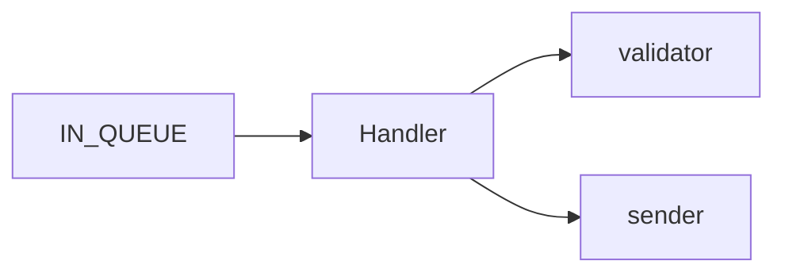
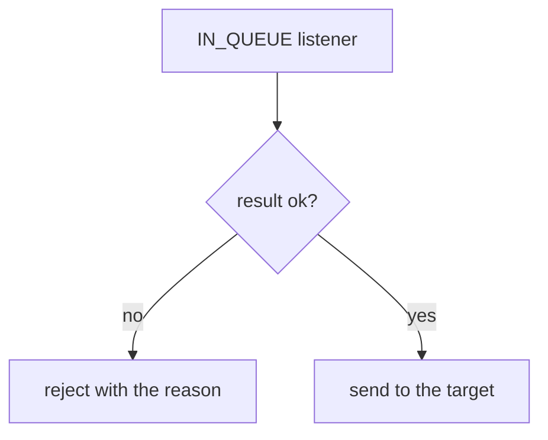

# Map: svc-a

## Shape
- language: Java, no build tool in the source | svc-a/Handler.java:1 | package demo;
- runtime: a consumer of the queue IN_QUEUE | svc-a/Handler.java:4 | @Listener(queue = "IN_QUEUE")
- artifact: the Handler class, no deploy artifact in the source | svc-a/Handler.java:3 | public class Handler {
- purpose: one Java handler takes each message from a queue | svc-a/Handler.java:3 | public class Handler {
- build: none found
- test: none found
- run: none found

## Architecture

- queue: the handler listens on the queue `IN_QUEUE` | svc-a/Handler.java:4 | @Listener(queue = "IN_QUEUE")
- handler: the class `Handler` takes the message | svc-a/Handler.java:3 | public class Handler {
- validator: the validator checks each message | svc-a/Handler.java:6 | validator.validate(message)
- sender: the sender sends the message to the target | svc-a/Handler.java:11 | sender.send(message);

## Entry points
- listener IN_QUEUE -> receive | svc-a/Handler.java:4 | @Listener(queue = "IN_QUEUE")

## Flows
### receive: What happens to a message from the queue?

- listen: the listener takes the message from the queue | svc-a/Handler.java:4 | @Listener(queue = "IN_QUEUE")
- check: the result of the check picks the path | svc-a/Handler.java:7 | if (!result.ok()) {
- reject: a bad message is refused with the reason | svc-a/Handler.java:8 | reject(message, result.reason());
- send: a good message goes to the target | svc-a/Handler.java:11 | sender.send(message);

## State
none found

## Formats and transforms
- the handler takes a `Message` object | svc-a/Handler.java:5 | public void receive(Message message) {

## Routing config
none found

## Error paths
- a bad message is refused with the reason of the check | svc-a/Handler.java:8 | reject(message, result.reason());

## Other systems
- target: `sender.send` | svc-a/Handler.java:11 | sender.send(message);

## Not covered
none found
