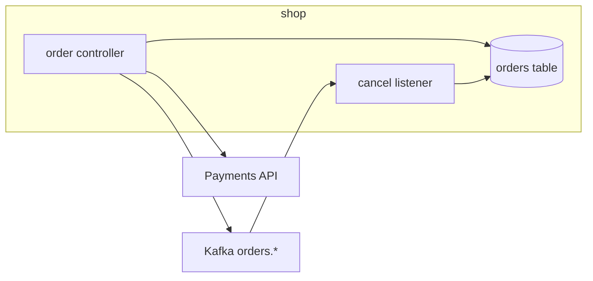
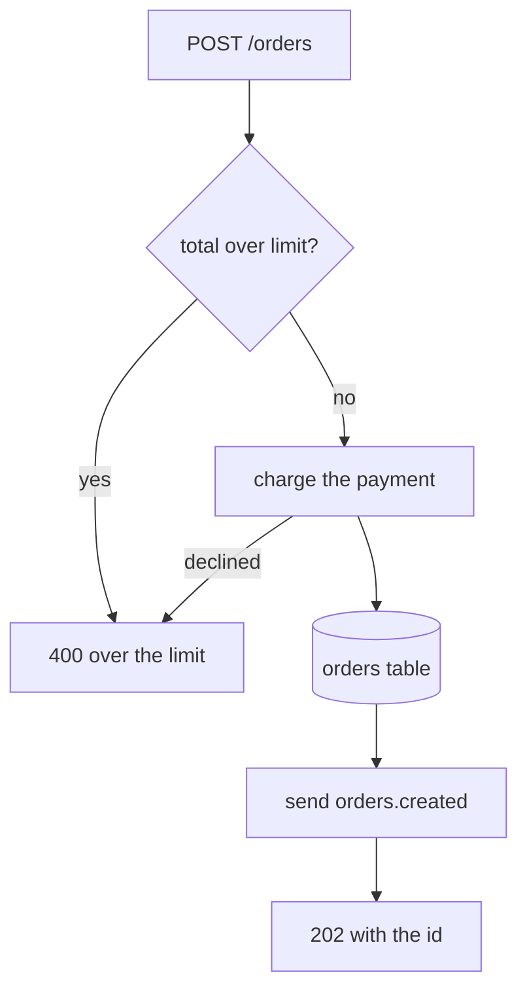
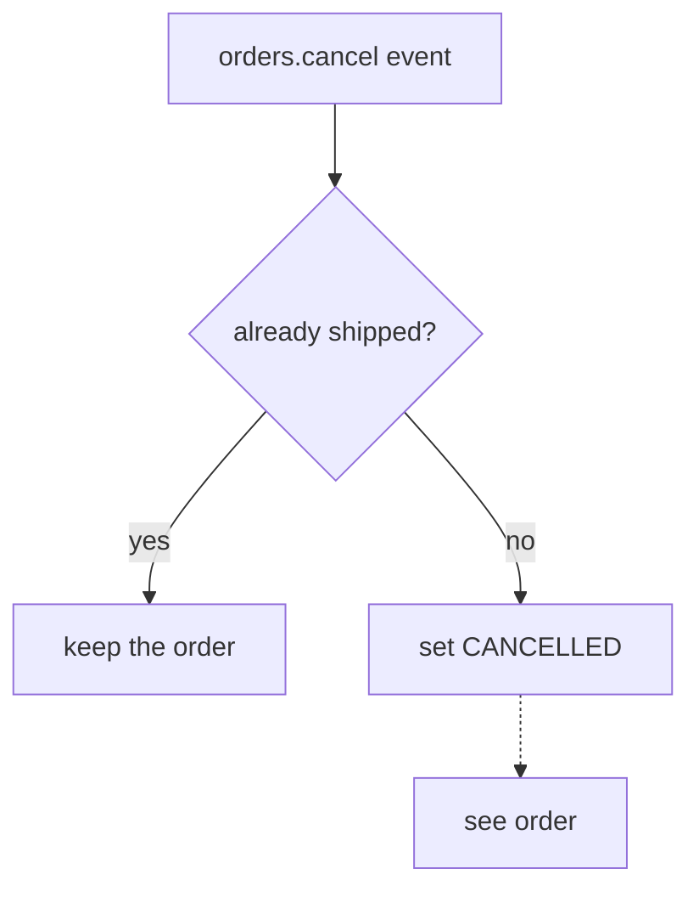
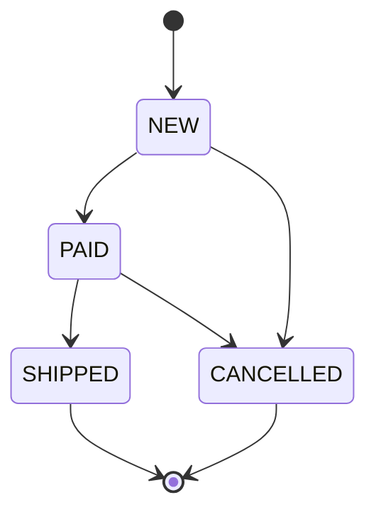

# Map: shop

## Shape
- language: Java and Kotlin service built with Gradle Kotlin DSL | build.gradle.kts:2 | java
- framework: Spring Boot 3.3.0 | build.gradle.kts:3 | id("org.springframework.boot") version "3.3.0"
- runtime: runs as one Spring Boot application | src/main/java/shop/ShopApplication.java:9 | SpringApplication.run(ShopApplication.class, args);
- artifact: deploys as the Spring Boot jar of shop.ShopApplication | build.gradle.kts:7 | mainClass.set("shop.ShopApplication")
- purpose: takes orders over HTTP, charges them and announces them on Kafka | src/main/java/shop/OrderController.java:7 | @RequestMapping("/orders")
- build: `./gradlew build` | build.gradle.kts:1 | plugins {
- test: `./gradlew test` | build.gradle.kts:2 | java
- run: `./gradlew bootRun` | build.gradle.kts:7 | mainClass.set("shop.ShopApplication")

## Architecture

- api: the order controller under /orders | src/main/java/shop/OrderController.java:8 | public class OrderController {
- repo: the order repository over the orders table | src/main/java/shop/OrderController.java:10 | private final OrderRepository repository;
- listener: the Kafka listener of cancel events | src/main/java/shop/OrderListener.java:5 | public class OrderListener {
- payments: the payments client charges an order | src/main/java/shop/OrderController.java:11 | private final PaymentsClient payments;
- kafka: a Kafka template publishes created orders | src/main/java/shop/OrderController.java:12 | private final KafkaTemplate<String, String> kafka;

## Entry points
- main shop-gw -> not an entry point: the start of the Go gateway process | cmd/shop-gw/main.go:9 | func main() {
- http GET /health -> not an entry point: a liveness probe | cmd/shop-gw/main.go:12 | r.GET("/health", health)
- http /metrics -> not traced: the gateway is not covered | cmd/shop-gw/main.go:13 | http.HandleFunc("/metrics", metrics)
- listener consumer -> not traced: the gateway is not covered | cmd/shop-gw/main.go:14 | go consumer.Consume(ctx, handle)
- schedule ticker every minute -> not traced: the gateway is not covered | cmd/shop-gw/main.go:15 | ticker := time.NewTicker(time.Minute)
- route ShopServer -> not traced: the gateway is not covered | cmd/shop-gw/main.go:17 | pb.RegisterShopServer(grpcServer, &shopServer{})
- route jms:queue:legacy.in -> not traced: it only logs | config/camel-context.xml:4 | <from uri="jms:queue:legacy.in"/>
- route kafka:stock.updates -> not traced: it only logs | routes/stock.camel.yaml:1 | - from:
- route timer:stock -> not traced: it has no steps | routes/stock.camel.yaml:5 | - from: { uri: "timer:stock" }
- http POST /orders -> order | src/main/java/shop/OrderController.java:14 | @PostMapping
- http GET /orders/{id} -> not traced: a plain read of one row | src/main/java/shop/OrderController.java:25 | @GetMapping("/{id}")
- http DELETE /orders/{id} -> cancel | src/main/java/shop/OrderController.java:30 | @RequestMapping(method = RequestMethod.DELETE, path = "/{id}")
- listener orders.cancel -> cancel | src/main/java/shop/OrderListener.java:12 | @KafkaListener(topics = "orders.cancel")
- main ShopApplication -> not an entry point: the Spring Boot start | src/main/java/shop/ShopApplication.java:8 | public static void main(String[] args) {
- route jms:queue:shop.in -> not traced: it only logs | src/main/java/shop/ShopRoutes.java:8 | from("jms:queue:shop.in")
- schedule StockJobs.refresh hourly -> not traced: stock is not covered | src/main/kotlin/shop/StockJobs.kt:6 | @Scheduled(cron = "0 0 * * * *")
- listener StockDelegate -> not traced: stock is not covered | src/main/kotlin/shop/StockJobs.kt:12 | class StockDelegate : JavaDelegate {
- main stock jobs -> not an entry point: a local run of the jobs | src/main/kotlin/shop/StockJobs.kt:18 | fun main(args: Array<String>) {

## Flows
### order: What happens to a new order?

- recv: the controller takes the order body | src/main/java/shop/OrderController.java:15 | public ResponseEntity<String> create(@RequestBody Order order) {
- valid: the total is checked against the limit | src/main/java/shop/OrderController.java:16 | if (order.total() > LIMIT) {
- reject: an order over the limit is a 400 | src/main/java/shop/OrderController.java:17 | return ResponseEntity.badRequest().body("over the limit");
- charge: the payments client charges the order | src/main/java/shop/OrderController.java:19 | payments.charge(order);
- save: the order row | src/main/java/shop/OrderController.java:20 | repository.save(order);
- publish: the created event goes to Kafka | src/main/java/shop/OrderController.java:21 | kafka.send("orders.created", order.id());
- reply: the id comes back with a 202 | src/main/java/shop/OrderController.java:22 | return ResponseEntity.accepted().body(order.id());

### cancel: How is an order cancelled?

- listen: the listener reads the cancel event | src/main/java/shop/OrderListener.java:13 | public void onCancel(String id) {
- shipped: a shipped order is not cancelled | src/main/java/shop/OrderListener.java:15 | if (order.status() == Order.Status.SHIPPED) {
- ignore: the listener returns and keeps the order | src/main/java/shop/OrderListener.java:16 | return;
- cancel: the status is set to CANCELLED | src/main/java/shop/OrderListener.java:18 | order.setStatus(Order.Status.CANCELLED);
- next: the row is saved as in the order flow | src/main/java/shop/OrderListener.java:19 | repository.save(order);

## State

- NEW: a new order starts in NEW | src/main/java/shop/Order.java:8 | private Status status = Status.NEW;
- PAID: the status after the charge | src/main/java/shop/Order.java:4 | PAID
- SHIPPED: a shipped order is not cancelled | src/main/java/shop/Order.java:4 | SHIPPED
- CANCELLED: set by the cancel listener | src/main/java/shop/Order.java:13 | public void setStatus(Status status) { this.status = status; }

## Events
### OrderPlacedEvent
- type: the record `OrderPlacedEvent` carries a placed order | src/main/java/shop/OrderPlacedEvent.java:3 | public record OrderPlacedEvent(String id, long total) {
- stream: `in-process`, a Spring application event | src/main/java/shop/OrderPublisher.java:7 | events.publishEvent(new OrderPlacedEvent(order.id(), order.total()));
- emits: `OrderPublisher` publishes it for a placed order -> order | src/main/java/shop/OrderPublisher.java:7 | events.publishEvent(new OrderPlacedEvent(order.id(), order.total()));
- consumes: `OrderProjection` reads the order back when it is placed -> order | src/main/java/shop/OrderProjection.java:6 | public void on(OrderPlacedEvent event) {

### orders.created
- type: the Kafka topic key `orders.created` sent for a created order | src/main/java/shop/OrderController.java:21 | kafka.send("orders.created", order.id());
- payload: the order id, a string taken from the `Order` class | src/main/java/shop/Order.java:3 | public class Order {
- stream: the Kafka topic `orders.created` | src/main/java/shop/OrderController.java:21 | kafka.send("orders.created", order.id());
- emits: `OrderController` sends it after the order row is saved -> order | src/main/java/shop/OrderController.java:21 | kafka.send("orders.created", order.id());
- consumes: outside: Billing `orders.created` | src/main/java/shop/OrderController.java:21 | kafka.send("orders.created", order.id());

## Formats and transforms
- order bodies are JSON bound by Spring | src/main/java/shop/OrderController.java:15 | @RequestBody Order order

## Routing config
- the legacy Camel route sends what it reads to a log | config/camel-context.xml:5 | <to uri="log:legacy"/>

## Error paths
- an order over the limit is a 400 with a text body | src/main/java/shop/OrderController.java:17 | ResponseEntity.badRequest().body("over the limit")

## Other systems
- Payments: `PaymentsClient` `payments.charge` | src/main/java/shop/OrderController.java:11 | private final PaymentsClient payments;
- Kafka: `orders.created` `orders.cancel` | src/main/java/shop/OrderListener.java:12 | @KafkaListener(topics = "orders.cancel")

## Conventions
- tests: test classes sit under src/test/java in the package of the class, named <Class>Test | src/test/java/shop/OrderControllerTest.java:3 | class OrderControllerTest {
- errors: an order over the limit is answered with a 400 through ResponseEntity | src/main/java/shop/OrderController.java:17 | return ResponseEntity.badRequest().body("over the limit");
- wiring: a dependency is a private final field of the class | src/main/java/shop/OrderController.java:11 | private final PaymentsClient payments;
- naming: a class is named for its role in the message path, such as Listener or Controller | src/main/java/shop/OrderListener.java:5 | public class OrderListener {

## Where to look
- add-http: `src/main/java/shop/` | src/main/java/shop/OrderController.java:14 | @PostMapping
- add-listener: `src/main/java/shop/` | src/main/java/shop/OrderListener.java:12 | @KafkaListener(topics = "orders.cancel")
- add-route: `routes/` | routes/stock.camel.yaml:1 | - from:
- add-schedule: `src/main/kotlin/shop/` | src/main/kotlin/shop/StockJobs.kt:6 | @Scheduled(cron = "0 0 * * * *")
- change-routing: `config/` | config/camel-context.xml:5 | <to uri="log:legacy"/>
- add-transform: `src/main/java/shop/` | src/main/java/shop/OrderController.java:15 | @RequestBody Order order
- add-test: `src/test/java/shop/` | src/test/java/shop/OrderControllerTest.java:3 | class OrderControllerTest {

## Not covered
- cmd/shop-gw: the Go gateway; its entry points are listed, its flows not traced
