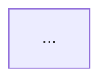

# sdr

`sdr` runs one system design review. It starts from a question about a change to a system. Searchers read the
code and the web. You settle the requirements with the user, and you write at least three options. A consilium
of three reviewers judges the options, and you write the decision.

The record of the review is `sdr.md`, and `sdr.py check` passes it at the end of each stage. A page shows the
result. Only the user starts a review, with `/sdr`.

You are the author: the main session. `<skill-dir>` is the base directory of this skill, printed when it starts.
`explain` is its sibling `<skill-dir>/../explain`, and `ste` is `<skill-dir>/../ste`. The prose of the page
follows the STE profile of `<skill-dir>/../ste/SKILL.md`.

## Contract

Syntax: `/sdr <question> [<code-dir> ...]` starts a run. `/sdr <sdr-dir>` resumes a run.

The arguments of this run: `$ARGUMENTS`

1. A word that starts with `--` is an error. Print `usage: /sdr <question> [<code-dir> ...]` and
   `/sdr <sdr-dir>` on two lines, and stop.
2. One argument that is a directory holding `sdr.md` resumes that run. It is never a code directory. Go on as
   "Stages" says for a resume.
3. Each other word that is an existing directory (after `~` expansion) is a code directory. The rest, joined
   with spaces, is the question.
4. If the question is empty and no run resumes, ask the user for the question. Make it the first message of
   the conversation. This is not a usage error.
5. If there is no code directory, ask once if the question is about code, and where the code is. `none` is a
   valid answer. The run then has web searchers only. Each directory that the user names must exist. Ask again
   for a directory that does not exist.
6. When you know the question and the code directories, do not stop. Print them. Then do the intake stage,
   and start the explore stage.

## Output directory

Make the output directory `~/karpathy/out/YYYY-MM-DD-HHMMSS-sdr-<slug>/`. The time stamp is local time. Make
the `<slug>` from the question by convention 5 of `<skill-dir>/../explain/SKILL.md`. Git ignores `out/`. Never
commit it.

Below, `<sdr-dir>` is the absolute path of this directory. On a resume, `<sdr-dir>` is the directory of the
argument.

| Path | Holds |
|---|---|
| `sdr.md` | The record (see "The record"). The source of truth of the page. |
| `explore/code-<id>.md` | The facts of one code searcher. |
| `explore/web-<n>.md` | The facts of one web searcher. `<n>` counts from 1. |
| `consilium/<role>.md` | The report of one consilium reviewer. |
| `review/review-round-<k>.md` | The report of the cold reviewer, round `<k>`. |
| `diagrams/<id>.mmd`, `.svg` | The Mermaid diagrams of the page, copied verbatim from `sdr.md`. Here `<id>` names the diagram. |
| `index.html` | The page. |
| `page.png`, `narrow.png`, `review/*.png` | The snapshots, as for an `explain` page. |

In `explore/code-<id>.md`, `<id>` is the slug of the basename of the code directory, by convention 5. When
two code directories give the same `<id>`, add `-2`, `-3` and so on to the later ones, in argument order.

## Stages

Line 2 of `sdr.md` holds the last finished stage, as `stage: <name>`. The stages, in order:

| Stage | Who | What | Ends with |
|---|---|---|---|
| `intake` | you and the user | Settle the question and the code directories. Make the output directory and the record skeleton. | `stage: intake` |
| `explore` | searchers | Start the code searchers and the web searchers in parallel. Wait for all. Check each fact file. | `stage: explore` |
| `frame` | you and the user | Play back the problem with the facts. Settle the requirements, one question at a time. Write the frame and the option shortlist. Stop 1: the user approves the frame, or corrects it. | `stage: frame` |
| `options` | you | Write each option in full. | `stage: options` |
| `consilium` | 3 reviewers | Start the three reviewers in parallel. Wait for all. Copy each verdict into the record. Apply the fit corrections that the evidence supports, and record each rejected one with the reason. | `stage: consilium` |
| `decide` | you | Write `Decision`, `Open questions` and `Not covered`. | `stage: decide` |
| `page` | you | Write `index.html`, and run the checks until they are clean. | `stage: page` |
| `review` | cold reviewer | Rounds of cold review. Fix each finding, or record the dispute. | `stage: review` |
| `done` | you | The handoff. Stop 2. | `stage: done` |

A stage ends when you write its name, the next name of the table, on line 2. Then run this command until it
prints `sdr: ok`:

```
python3 <skill-dir>/scripts/sdr.py check <sdr-dir>
```

It prints one finding line for each fault, then `sdr: ok` or `sdr: <n> findings`. Fix `sdr.md` for each
finding line, and run the command again. If it exits with code 2, print its line and stop.

A resume reads line 2 and goes on with the next stage. It reads the question from line 1, the root from line 3
and the code directories from line 4. On a resume at stage `frame`, do Stop 1 again before the options stage.
A run at stage `done` has no next stage: do Stop 2 again.

A run stops for the user only at Stop 1 and Stop 2. Do not stop between the other stages.

## The record

`sdr.md` is the record of the review. `sdr.py skeleton` writes it at stage `intake`, with each section
`pending`. You write the sections, stage by stage, in this form:

````
# SDR: <question>
stage: <stage>
root: <absolute root>
code: <absolute code dir>; <absolute code dir>   (or `none`)

## Problem
<one to three short paragraphs>

## Context
- <fact> | <path>:<line> | <snippet>
- <fact> | <url> | <snippet>

## Functional requirements
- FR-1: <requirement> | source: user
- FR-2: <requirement> | source: code | <path>:<line> | <snippet>
- FR-3: <requirement> | source: assumption
- FR-4: <requirement> | source: consilium <role>

## Non-functional requirements
- NFR-1: <requirement> | target: <measurable target or unknown> | source: <as above>

## Constraints
- <constraint> | source: <as above>

## Non-goals
- <non-goal>

## Options
### opt-a: <name>
<one paragraph: how it works>

- changes: <service>: <change>; <service>: <change>
- pros: <pro>; <pro>
- cons: <con>; <con>
- risks: <risk>; <risk>
- effort: S|M|L — <reason>
- reversibility: easy|hard — <reason>
- fit FR-1: meets|partial|fails — <reason>
- fit NFR-1: meets|partial|fails — <reason>

## Consilium
### architect
- preferred: opt-<x>
- verdict: <one sentence>
- correction opt-<x> FR-<n>: <old> -> <new> — accepted|rejected: <reason>

## Decision
- choice: opt-<x>
- why: <reason, by requirement ids>
- why not opt-<y>: <reason>
- dissent: <role> preferred opt-<y>: <their reason>; <why the decision stands>
- revisit when: <condition>
- next steps: <step>; <step>

## Open questions
- <question>

## Not covered
- <topic>: <reason>
````

`sdr.py check` enforces these rules for each section that the stage reaches:

- The level-2 sections are the eleven of the block, in that order.
- The frame stage reaches the first seven sections, the consilium stage reaches `Consilium`, and the decide
  stage reaches the last three. A section that the stage has not reached holds the one line `pending`.
- An empty section that the stage reaches holds `none`.
- Line 2 is `stage:` with one of the nine names of "Stages". `sdr.py skeleton` writes `root:` on line 3 and
  `code:` on line 4. Do not change them.
- At stage `frame`, `Options` holds the shortlist: at least three `### opt-<letter>: <name>` headers. Each
  holds the one line `pending`. From stage `options` on, each holds the full block.
- A cite is `<path>:<line> | <snippet>` or `<url> | <snippet>`. The path is relative to the root. The snippet
  is on that line, with at most 12 words, copied verbatim. For a URL cite, the check reads the form only.
- Requirement ids are `FR-<n>` and `NFR-<n>`. They are unique and numbered from 1, with no gaps.
- Each requirement has a `source:`. It is `user`, `code` with a path cite, `web` with a URL cite,
  `assumption`, or `consilium <role>`. Each NFR has a `target:` before its `source:`.
- Each constraint has a `source:` of the same form.
- An assumption that the user confirms at Stop 1 changes its source to `user`. A requirement that keeps
  `source: assumption` goes on the page under "To confirm", and into the handoff.
- `Options` holds at least three option blocks. Each block holds a lead paragraph and one Mermaid `flowchart`
  of at most 25 nodes.
- Each block holds the keys `changes`, `pros`, `cons`, `risks`, `effort` and `reversibility`, each once and
  not empty. `pros` and `cons` each hold one item or more.
- Each block holds exactly one `fit <id>:` line for each requirement id. The line has `meets`, `partial` or
  `fails`, then ` — ` and a reason.
- `Consilium` holds the three roles `architect`, `operator` and `sceptic`, in that order. Each role has a
  `- preferred:` line with an option id and a `- verdict:` line.
- A correction line names an option, a requirement, two marks, and `accepted` or `rejected` with a reason. The
  `fit` line of an option now has the new mark of each accepted correction.
- In `Decision`, `choice:` names an option. Write one `why not opt-<y>:` line for each other option.
- Write one `dissent:` line for each role whose `preferred` is not the choice. Write one `revisit when:` line or
  more.
- When the choice has a `fails` mark that another option `meets`, `why:` names that requirement id.
- From stage `page` on, `sdr.py check` also compares the matrix of `index.html` with the record.

These rules of form apply too:

- Put no fenced block outside `Options`.
- Never use `~~~`.
- Write a `### ` heading only under `Options` and `Consilium`.
- Each line of a cited section is one `- ` line. The cited sections are `Context`, the two requirement sections
  and `Constraints`.
- A fence starts at column 0 with three backticks.
- The record's prose is not linted. Code names are in backticks.

## Subagents

Each subagent is a fresh general-purpose subagent, never a fork: a fork has your context and your blind spots.
In Claude Code, use the Agent tool with the `general-purpose` agent type. In OpenCode, use the `task` tool with
the `general` agent. Each subagent writes one file and changes nothing else.

| Prompt | Stage | Writes |
|---|---|---|
| `<skill-dir>/prompts/search-code.md` | `explore` | `explore/code-<id>.md` |
| `<skill-dir>/prompts/search-web.md` | `explore` | `explore/web-<n>.md` |
| `<skill-dir>/prompts/consilium.md` | `consilium` | `consilium/<role>.md` |
| `<skill-dir>/prompts/review.md` | `review` | `review/review-round-<k>.md` |

Each prompt is a template. Read it. Replace each name in braces with plain text. Give the result to the
subagent as its prompt. A filled prompt holds no name in braces. Fill the names like this:

| Name | Prompts | Fill with |
|---|---|---|
| `{skill_dir}` | `search-code.md`, `search-web.md` | The absolute path of `<skill-dir>`. |
| `{question}` | `search-code.md`, `search-web.md`, `review.md` | Line 1 of `sdr.md`, after `# SDR: `. |
| `{code_dir}` | `search-code.md` | The absolute path of one code directory. |
| `{topic}` | `search-web.md` | The one topic of this web searcher. |
| `{root}` | `search-code.md`, `search-web.md`, `consilium.md`, `review.md` | Line 3 of `sdr.md`, after `root: `. |
| `{fact_id}` | `search-code.md`, `search-web.md` | `<id>` for a code searcher, `web-<n>` for a web searcher. |
| `{facts}` | `search-code.md`, `search-web.md` | The absolute path of `explore/code-<id>.md` or `explore/web-<n>.md` in `<sdr-dir>`. |
| `{role}` | `consilium.md` | The role of one row of the role table below, without backticks. |
| `{brief}` | `consilium.md` | The brief of that row, word for word. |
| `{files}` | `consilium.md`, `review.md` | Absolute paths, one on each line. For the consilium: `sdr.md`, then each fact file. For the review: `index.html`, `sdr.md`, then each fact file. |
| `{report}` | `consilium.md`, `review.md` | The absolute path of `consilium/<role>.md`, or of `review/review-round-<k>.md`, in `<sdr-dir>`. |
| `{previous}` | `review.md` | `none` in round 1. In round 2: the absolute path of the round-1 report, with your `## Author` block. For a verification read: the absolute path of the round-2 report. |

The consilium has three roles. Each reviewer gets one row:

| Role | Brief |
|---|---|
| `architect` | Fit with the existing architecture and its ownership boundaries: which service owns which fact, coupling, how each option evolves when the next source system arrives. |
| `operator` | What breaks at run time: ordering, duplicates, retries, replay, partial failure, back-pressure, migration from the legacy flow, how an operator sees and fixes a stuck case. |
| `sceptic` | Attack the leading option and the frame: a requirement that is wrong or missing, an option written to lose, a cheaper option that nobody wrote, an assumption that carries the decision. |

Start no other subagent. You write the options and the decision: a subagent that writes them needs the whole
conversation of the frame stage. Read the fact files and each result line, never the raw code that a searcher
read.

## Intake

1. Make each code directory an absolute path. Find the root of the run, as the course rung of `explain` finds
   it. The root is the deepest common ancestor directory of the code directories. If that directory is a code
   directory, use its parent directory. This is so for one code directory, and for a code directory that holds
   another. With no code directory, the root is the current directory.
2. Make the output directory (see "Output directory").
3. Run this command, with one `--code` for each code directory:

   ```
   python3 <skill-dir>/scripts/sdr.py skeleton <sdr-dir> --question "<question>" --root <root> [--code <code-dir>]...
   ```

   If the question holds a `"`, a `$` or a backtick, escape it for the shell.
4. The command writes `sdr.md` at stage `intake`. Run the check (see "Stages").

## Explore

Start these searchers at the same time, in parallel:

- one code searcher for each code directory, with the prompt `<skill-dir>/prompts/search-code.md`;
- one to three web searchers, with the prompt `<skill-dir>/prompts/search-web.md`.

Give each web searcher one topic. Pick each topic from the question. A topic is prior art, the named patterns
that apply, or the documentation of a library or a platform for the options. Give the web searchers the ids
`web-1`, `web-2` and `web-3`.

Wait for all. The reply of a searcher ends with one line: `facts: done <id> <n> facts` or
`facts: failed <reason>`. Print each of these lines. Keep each `facts: failed` searcher for `Not covered`.

Then run this command on each fact file, with the root of the run as `<root>`:

```
python3 <skill-dir>/scripts/sdr.py check-facts <sdr-dir>/explore/<file> --root <root>
```

`<file>` is the name of the fact file. If findings remain, delete each fact line that a finding names, and run it again. Read all the findings of one
run before you delete a line, because a deletion changes the numbers of the next lines. Use no fact that a
finding still names.

Write `stage: explore` and run the check.

## Frame

Read each fact file. Then talk with the user until you both agree on the requirements. Follow these rules:

- Ask one question in each message. Ask open questions first, for example "walk me through the last time this
  went wrong".
- A guess that the user can correct beats a question.
- Play back the problem, then the functional requirements (FRs), then the non-functional requirements (NFRs).
  Play back each part in a short chunk, and ask what is wrong or missing. Mark each guess as a guess.
- Cover this territory. Never read it out to the user as a list:
  - the users of the change, and what they see;
  - what happens today, with the facts of the searchers;
  - the FRs;
  - the NFRs of load and order: volume and latency, ordering and consistency, duplicates and idempotency;
  - the NFRs of failure and control: failure and recovery, audit and compliance, security and personal data;
  - the NFRs of operation and change: observability, migration and coexistence with the legacy flow, cost and
    effort;
  - the constraints that the user cannot change;
  - the non-goals;
  - the options that the user considered or rejected before, and why.
- An NFR has a measurable target, or it says `target: unknown`. Each `target: unknown` becomes an open
  question.
- When the user says "just guess" or "you decide", write the requirement with `source: assumption`, and go on.

Then write these sections of `sdr.md`:

- `Problem`: one to three short paragraphs.
- `Context`: the facts from the fact files that bear on the question. Copy each fact line with its cite
  unchanged. From a flow line, drop the `<node-id>: ` before the fact.
- `Functional requirements` and `Non-functional requirements`.
- `Constraints` and `Non-goals`.
- `Options`: the shortlist. Write at least three `### opt-<letter>: <name>` headers, each with the one line
  `pending`. One option of the shortlist is the smallest change that could work.

Write `stage: frame` and run the check.

Then do Stop 1. Show the requirements, the assumptions and the shortlist in chat, and ask for approval. The
user can add an option or reject one. When fewer than three options remain, add one. `go` approves.

When the user confirms an assumption, change its source to `source: user`. Run the check again after each
change. After the approval, start the options stage.

## Options

Write each option of the shortlist in full, in place of its `pending` line:

- a lead paragraph: how the option works;
- one Mermaid `flowchart` of at most 25 nodes;
- the six keys `changes`, `pros`, `cons`, `risks`, `effort` and `reversibility`, in the form of "The record";
- one `fit <id>:` line for each requirement, with `meets`, `partial` or `fails`, then ` — ` and the reason.

Keep each option name short, at most 40 characters: the matrix headers render vertically. No option is a
strawman: each pro is real, and the cited facts support each con.

Write `stage: options` and run the check.

## Consilium

Start the three consilium reviewers at the same time, in parallel, with the prompt
`<skill-dir>/prompts/consilium.md`. Fill each prompt with one row of the role table. Wait for all.

Each reviewer writes `consilium/<role>.md`. The report ends with two lines: `verdict: <one sentence>`, then
`preferred: opt-<x>`. The reply of the reviewer ends with the same two lines.

A report must end with a `preferred:` line that names an option of the record. If it does not, start that
reviewer again once, as a fresh subagent. A second failure stops the run: print the name of the role, and stop.

Copy each report into `Consilium`, in place of its `pending` line. Write one `### <role>` block for each role, in
the order `architect`, `operator`, `sceptic`:

1. Copy the last two lines of the report as `- preferred: opt-<x>` and `- verdict: <one sentence>`. Each line
   gets a `- ` in front.
2. Read each `dispute <id>: <old> -> <new> — <evidence>` line of the report. It is under an `## opt-<x>`
   block, and it disputes the fit line of that option for the requirement `<id>`. Read its evidence.
3. Turn each `dispute` line into one line
   `- correction opt-<x> <id>: <old> -> <new> — accepted|rejected: <reason>`. Write `accepted` when the
   evidence supports the new mark. Else write `rejected`. Give the reason.
4. For an accepted correction, change the `fit` line of that option for `<id>` to the new mark, with the reason.
5. Read each `missing <FR|NFR>: <requirement> — <evidence>` line of the report. Add each `missing` requirement
   that the evidence supports, with the next free id and `source: consilium <role>`.
6. A new NFR also gets a `target:`. Add a fit line for each new requirement to each option.

Skip a `dispute` line whose `<id>` is not a requirement id of the record. Two accepted corrections of one fit
line must give the same new mark.

Write `stage: consilium` and run the check.

## Decide

Choose the option that the fit marks support, with the consilium in mind. Write `Decision`:

- `- choice: opt-<x>`: the option that you choose.
- `- why: <reason>`: the reason, by requirement ids. Name each requirement that the choice fails and another
  option meets, and say why the choice still stands.
- `- why not opt-<y>: <reason>`: one line for each other option.
- `- dissent: <role> preferred opt-<y>: <their reason>; <why the decision stands>`: one line for each role whose
  `preferred` is not the choice.
- `- revisit when: <condition>`: one line or more.
- `- next steps: <step>; <step>`.

Write `Open questions`: one `- <question>` line for each question that is still open. Each `target: unknown`
is an open question.

Write `Not covered`: one `- <topic>: <reason>` line for each topic that the review does not cover. Each
`facts: failed` searcher is a topic here, with its reason.

Write `none` in a section that has no line.

Write `stage: decide` and run the check.

## Page

Write the page from the record. The page reports `sdr.md`: it states no requirement, mark, verdict or reason
that the record does not hold. Take each cite from `sdr.md` or from a fact file. Its path is relative to the
root.

Copy `<skill-dir>/../explain/templates/page.html` to `<sdr-dir>/index.html`. Then follow these sections of
`<skill-dir>/../explain/rungs/page.md`: "Fill the template", "Diagram patterns", "Provenance",
"Write the prose" and "Verify and export". In that file, `<skill-dir>` is the directory of `explain`, here
`<skill-dir>/../explain`, and `<output-dir>` is `<sdr-dir>`. Use the section plan below in place of
"Plan the sections".

Keep `<meta name="explain-rung" content="page">`, so that `verify.sh` checks the page as a page of `explain`.
Write the prose in the STE profile of `<skill-dir>/../ste/SKILL.md`. Write it in English, or in Russian when
the user asks, by convention 7 of `<skill-dir>/../explain/SKILL.md`.

The section plan, in document order:

- `<h1>`: the question, from line 1 of `sdr.md`. The answer box gives the choice and its two strongest reasons,
  by requirement id, in at most 70 words.
- `#why` "Why does this need a decision?": the problem, and one Mermaid diagram of the current state, from the
  fact files. A node of the class `gap` marks the gap, and `classDef gap` in the diagram defines the class.
  This line is the one style in a diagram: "Diagram patterns" forbids each other style.
- `#requirements` "What must the solution do?": two tables, functional and non-functional, with the columns id,
  requirement, target and source. Then the constraints, the non-goals, and a list headed "To confirm" with
  each requirement that keeps `source: assumption`.
- `#compare` "How do the options compare?": one sentence that explains the three marks, then an empty
  `<div class="sdr-matrix"></div>`. Cover the prose: the matrix alone must support the answer box.
- One section for each option, with the id `opt-<x>`. Its `<h2>` asks the name of the option as a question.
  It holds the lead paragraph, the diagram of the option and the six keys. A `details.walk`
  "Fit by requirement" ends it, with the reason of each fit line.
- `#consilium` "What did the reviewers say?": a table of role, preferred option and verdict. Then one paragraph
  for each role, with its strongest argument. A dissent gets its own paragraph.
- `#decision` "What do we choose, and when do we revisit it?": the choice, why, why not each other option, the
  revisit conditions, the next steps and the open questions.
- `#terms`: the glossary, as "Plan the sections" defines it.
- The footer: the provenance, with `data-kind="topic"` and the root of the run in `data-root`, not the root
  of a repository. The Source cell names the root and each URL that the page cites. Write one Commit and one
  Dirty value for each code directory, with its basename in the `<dt>`. Commit is the output of
  `git -C <code-dir> rev-parse --short HEAD`. Dirty is `dirty` when `git -C <code-dir> status --porcelain`
  prints a line, else `no`. With no code directory, Commit is `none` and Dirty is `no`. `Not covered` lists
  each topic of `Not covered` of the record.

Copy each Mermaid block of `sdr.md` verbatim to `diagrams/<id>.mmd`, with the option id as `<id>`. Write the
diagram of `#why` to `diagrams/why.mmd`. Then run this command:

```
python3 <skill-dir>/../explain/scripts/mermaid_svg.py inline <sdr-dir>/index.html
```

Then run this command until it prints `sdr: ok`:

```
python3 <skill-dir>/scripts/sdr.py matrix <sdr-dir>
```

It writes the matrix into the `sdr-matrix` block: one row for each requirement, one column for each option,
and the chosen column marked. The block holds its own `<style>`, so add no CSS for it.
Never quote `<div class="sdr-matrix">` in an HTML comment. `sdr.py` counts each copy of that tag, in a
comment too.

Run this command until each line shows `ok`, and the `bpmn` line shows `none`:

```
<skill-dir>/../explain/scripts/verify.sh <sdr-dir>/index.html
```

Then take the snapshots and read the tiles, as "Verify and export" says. Skip its handoff step: "Done" does
the handoff.

Write `stage: page` and run the check. `page: matrix stale` means that `sdr.md` changed after the matrix: run
the matrix command again, then the check.

## Review

A cold reviewer reads the page and the record, with no context of the run. Start it as a fresh subagent with
the prompt `<skill-dir>/prompts/review.md`, filled as "Subagents" says. In round 1, `{previous}` is `none`.

The reviewer writes `review/review-round-<k>.md`, where `<k>` is the number of the round. The last line of the
report is `verdict: ok` or `verdict: fix`. Fix each finding that its quoted source lines support. Then append
`## Author` to the report. For each finding, write `fixed` with what changed, or `not fixed` with why.

After each change to `sdr.md`, run `sdr.py matrix` again, then `sdr.py check`. Run `verify.sh` again after each
change to the page, until each line shows `ok`.

The rounds:

- Round 2 runs when round 1 says `verdict: fix`. A fresh reviewer gets the round-1 report as `{previous}`. It
  rules each round-1 finding `resolved` or `open`, then hunts for new faults.
- A finding first made in round 2 and fixed gets one verification read: round 3. A fresh reviewer gets the
  round-2 report as `{previous}`. It rules each finding of that report, and hunts for nothing new.
- There are three rounds at most.

After the last round, a finding is `open` unless its last ruling is `resolved`. Never overrule an `open`
finding alone: keep it for the handoff.

Write `stage: review` and run the check.

## Done

Write `stage: done` and run the check.

Then do Stop 2. Print the absolute path of `<sdr-dir>`, and run `open index.html` in it. Never run `open`
inside a subagent.

Then write one numbered list in chat, with exactly these five items, in this order:

1. The choice, in one sentence.
2. Each assumption still marked `To confirm`: each requirement that keeps `source: assumption`.
3. Each requirement with `source: consilium <role>`.
4. Each `open` finding of the review. For a finding that you dispute, add your reason.
5. Each open question of `Open questions`.

Write `none` in an item that has nothing. Read the items from `sdr.md` and the reports in `review/`, so that a
resume at stage `done` gives the same list.

Stop 2 prints the path, opens the page and writes this list. Nothing else.
