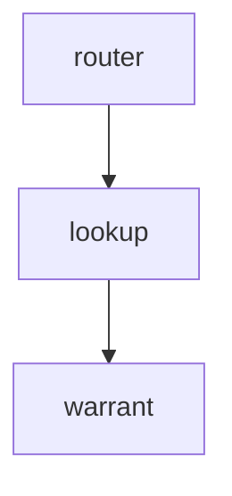

# Facts: orchestrator

## Shape

- Java service that maps each claim to its warrant | orchestrator/ClaimRouter.java:7 | public class ClaimRouter

## Relevant flows

### route: How does a claim reach a warrant?

- router: ClaimRouter holds the claim to warrant map | orchestrator/ClaimRouter.java:7 | public class ClaimRouter
- lookup: warrantOf reads the map by claim id | orchestrator/ClaimRouter.java:15 | public Optional<String> warrantOf
- warrant: an unknown claim gives no warrant | orchestrator/ClaimRouter.java:16 | Optional.ofNullable

## Facts

- Many claims can map to one warrant | orchestrator/ClaimRouter.java:8 | One claim, many warrants
- The map is handed to the router when it is built | orchestrator/ClaimRouter.java:11 | public ClaimRouter(Map<String, String> warrantByClaim)

## Unknowns

- Where the map is filled is not in this directory
