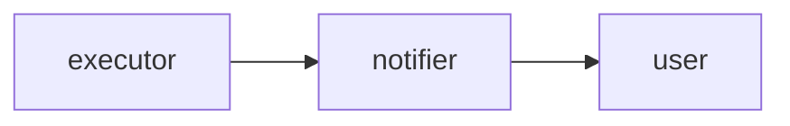
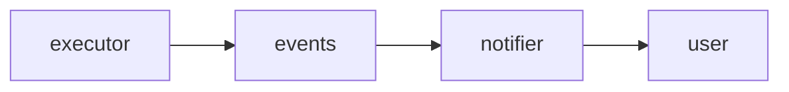
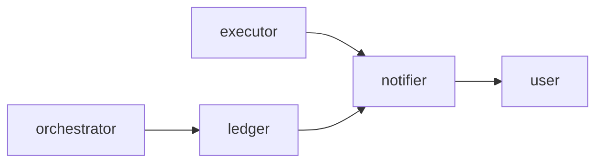

# SDR: How do we notify the end user of each warrant action?
stage: consilium
root: /fixture-root
code: /fixture-root/orchestrator; /fixture-root/executor

## Problem

The orchestrator turns claims into warrants and the executor publishes one event for each warrant action. One source system maps many claims to one warrant, so the event no longer says which claim caused the action.

## Context

- One source system maps many claims to one warrant | orchestrator/ClaimRouter.java:8 | Many claims, one warrant
- Each execution event carries the warrant total and no claim id | executor/WarrantEvents.java:6 | carries the warrant total and no claim id
- Notification per aggregate is a known pattern | https://martinfowler.com/articles/201701-event-driven.html | Event-Carried State Transfer

## Functional requirements

- FR-1: The end user is told about every block, unblock and confiscation | source: user
- FR-2: A notification for a warrant with many claims names the claims behind the action | source: code | orchestrator/ClaimRouter.java:8 | Many claims, one warrant
- FR-3: The end user gets one notification for each action, not one for each claim | source: assumption

## Non-functional requirements

- NFR-1: The notification arrives soon after the action | target: within 60 s | source: user
- NFR-2: A failed notification never blocks or undoes an action | target: unknown | source: web | https://microservices.io/patterns/data/transactional-outbox.html | transactional outbox

## Constraints

- The executor keeps publishing the same events to its other consumers | source: user

## Non-goals

- Choosing the channel (mail, SMS or push) that carries the notification

## Options

### opt-a: Notify per warrant total

The notifier listens to the execution event that the executor already publishes and sends one notification for each warrant action. The text shows the warrant total and names no claim, because the event carries no claim id.

- changes: notifier: a new service that reads the execution events and sends the notification
- pros: no change to the executor; the smallest change of the three; one notification for each warrant action
- cons: the text cannot name the claims behind the action; the notifier depends on the shape of the event
- risks: the executor changes the event and the notifier breaks without a warning; a retry sends the same notification twice
- effort: S — one new service and no change in the existing ones
- reversibility: easy — remove the notifier and nothing else changes
- fit FR-1: meets — every block, unblock and confiscation is a warrant action with an event
- fit FR-2: fails — the event carries the warrant total and no claim id
- fit FR-3: meets — one event for each warrant action gives one notification
- fit NFR-1: meets — the notifier reads the event as it is published and waits for nothing
- fit NFR-2: partial — a failed send does not block the executor, but the notifier keeps no queue for a retry

### opt-b: Executor emits one event per claim action

The executor publishes one claim event for each claim of a warrant action, with the claim id and the action id on it, next to the event that it publishes today. The notifier groups the claim events of one action and sends one notification that names every claim.

- changes: executor: publish a claim event next to the existing event; notifier: group the claim events of one action and send one notification
- pros: the notification names every claim; the claim event is open to other consumers later
- cons: the executor publishes many events for one action; the notifier needs a grouping window
- risks: the notifier waits for a claim event that never arrives; the event volume grows with the claims of each warrant
- effort: M — two services change and the grouping needs a test with late events
- reversibility: easy — stop publishing the claim events and the existing event stays as it is
- fit FR-1: meets — each action produces claim events and so a notification
- fit FR-2: meets — each claim event carries the claim id
- fit FR-3: meets — the notifier groups the claim events of one action into one notification
- fit NFR-1: fails — the notifier waits for a grouping window of 90 s before it sends
- fit NFR-2: meets — the executor only publishes events and a failed send stays in the notifier

### opt-c: Orchestrator keeps a claim ledger

The orchestrator writes a ledger that lists the claims behind each warrant. The notifier reads the execution event, looks up the claims in the ledger by the warrant id and sends one notification. The executor does not change.

- changes: orchestrator: write the ledger when it maps a claim to a warrant; notifier: read the ledger for each event
- pros: the executor stays as it is; the notification names the claims
- cons: a second store must stay in step with the claim map; the orchestrator gains a new duty
- risks: the ledger lags behind the event and the notification misses a claim; the ledger rows grow without a cleanup rule
- effort: L — a new store, a new write path and a backfill for the open warrants
- reversibility: hard — the ledger data and its readers outlive a rollback
- fit FR-1: meets — every action has an event and the notifier reads it
- fit FR-2: meets — the ledger lists the claims behind the warrant
- fit FR-3: partial — a late ledger row can cause a second notification for the same action
- fit NFR-1: partial — the ledger read sits on the path of each notification and adds a wait
- fit NFR-2: meets — a failed ledger read falls back to the warrant total and the notification still goes

## Consilium

### architect

- preferred: opt-b
- verdict: opt-b keeps the claim facts in the executor, which owns them, and leaves the orchestrator as it is

### operator

- preferred: opt-b
- verdict: opt-b is the only option where an operator can trace a stuck notification to its claim events

### sceptic

- preferred: opt-a
- verdict: the target of NFR-1 is the stated need, and only opt-a meets it without a grouping window
- correction opt-c FR-3: meets -> partial — accepted: a late ledger row can send a second notification for the same action
- correction opt-b NFR-2: meets -> partial — rejected: the executor only publishes events, so a failed send stays in the notifier

## Decision

pending

## Open questions

pending

## Not covered

pending
