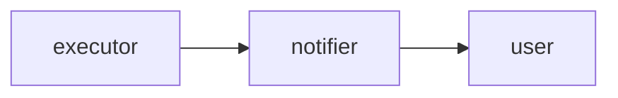
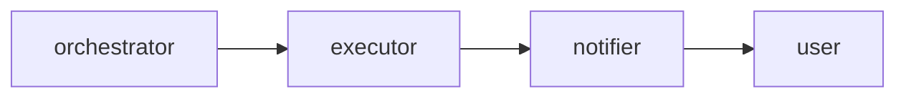
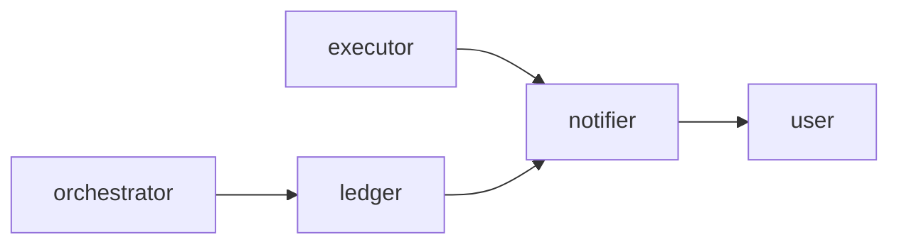

# SDR: How do we notify the end user of each warrant action?
stage: decide
root: /fixture-root
code: /fixture-root/orchestrator; /fixture-root/executor

## Problem

The orchestrator turns claims into warrants and sends the executor a command with the warrant totals. The executor publishes one event for each warrant action. One source system maps many claims to one warrant, so the event no longer says which claim caused the action.

The legacy flow told the end user about each claim by its id. The new notification must tell the end user about each warrant action, and it must still name the claim behind the action.

## Context

- By default one claim gives one warrant, and the claim id is the warrant id | orchestrator/WarrantMapper.java:23 | return claim.claimId();
- For the source system BULK the warrant id is the debtor id, so all the claims of a debtor share one warrant | orchestrator/WarrantMapper.java:21 | return claim.debtorId();
- The command to the executor holds the warrant id and the two totals and no claim id | orchestrator/WarrantMapper.java:9 | WarrantCommand(String warrantId, BigDecimal blockTotal, BigDecimal confiscateTotal)
- Each execution event holds the warrant id, the action, the amount and the warrant total after the action | executor/ExecutionEvent.java:5 | ExecutionEvent(String warrantId, Action action, BigDecimal amount, BigDecimal warrantTotal)
- The legacy flow runs for each claim and tells the end user at each step, with the claim id in the text | orchestrator/LegacyClaimWorkflow.java:13 | "Claim " + claim.claimId() + " is accepted"
- Notification per aggregate is a known pattern | https://martinfowler.com/articles/201701-event-driven.html | Event-Carried State Transfer

## Functional requirements

- FR-1: The end user is told about every block, unblock and confiscation of a warrant | source: user
- FR-2: A notification names the claim that caused the warrant action | source: code | orchestrator/WarrantMapper.java:21 | return claim.debtorId();
- FR-3: The end user gets one notification for each warrant action, not one for each claim | source: assumption
- FR-4: A second delivery of the same event sends no second notification | source: consilium sceptic

## Non-functional requirements

- NFR-1: The notification arrives soon after the warrant action | target: within 60 s | source: user
- NFR-2: The notifier keeps up with the peak rate of warrant actions | target: unknown | source: assumption

## Constraints

- The executor keeps publishing the events of the topic `warrant.executions` to its other consumers | source: user

## Non-goals

- Choosing the channel (mail, SMS or push) that carries the notification
- Changing the legacy flow of `LegacyClaimWorkflow`

## Options

### opt-a: Notify per warrant total

The notifier reads the `ExecutionEvent` that the executor already publishes and sends one notification for each warrant action. The text shows the action, the amount and the warrant total. It names no claim, because the event carries no claim id.

- changes: notifier: a new service that reads the execution events and sends the notification
- pros: no change in the orchestrator or the executor; the smallest change of the three; one notification for each warrant action
- cons: the text cannot name the claim behind the action; the notifier depends on the shape of the event
- risks: the executor changes the event and the notifier breaks without a warning; a second delivery of one event sends a second notification
- effort: S — one new service and no change in the existing ones
- reversibility: easy — remove the notifier and nothing else changes
- fit FR-1: meets — every block, unblock and confiscation is an event
- fit FR-2: fails — the event carries the warrant total and no claim id
- fit FR-3: meets — one event for each warrant action gives one notification
- fit FR-4: fails — the event has no id of its own, so a repeat looks like a new action
- fit NFR-1: meets — the notifier reads the event as the executor publishes it
- fit NFR-2: meets — the notifier adds no read and no write to the path of an event

### opt-b: Executor event carries the claim id

The orchestrator puts the id of the changed claim in the `WarrantCommand`. The executor copies it to the `ExecutionEvent` that it publishes. The notifier reads the event and names that claim in the text.

- changes: orchestrator: `WarrantMapper` puts the claim id in the command; executor: `WarrantCommandListener` and `ExecutionEvent` carry the claim id; notifier: a new service that reads the execution events
- pros: the notification names the claim that caused the action; no second store; the claim id travels with the event it belongs to
- cons: the event gets a new field that its other consumers also see; the executor carries a value that it does not use
- risks: a consumer of `warrant.executions` breaks on the new field; two services must change in the same release
- effort: M — two services change and the event contract grows by one field
- reversibility: easy — the new field is harmless when the notifier goes away
- fit FR-1: meets — every action produces an event, and so a notification
- fit FR-2: meets — the event carries the id of the claim that changed
- fit FR-3: meets — one event for each warrant action gives one notification
- fit FR-4: fails — the event still has no id of its own, and a claim can raise the same action twice with the same total
- fit NFR-1: meets — the notifier reads the event as the executor publishes it
- fit NFR-2: meets — the event grows by one field and the cost of an event does not change

### opt-c: Orchestrator keeps a claim ledger

The orchestrator writes a ledger row for each `WarrantCommand` that it sends: the warrant id, the id of the changed claim and the totals. The notifier reads the `ExecutionEvent`, finds the row by the warrant id and the warrant total, and names the claim in the text. The executor does not change.

- changes: orchestrator: write a ledger row for each command; notifier: a new service that reads the event and the ledger
- pros: the executor and its event stay as they are; each ledger row has a key that the notifier uses to skip a repeat
- cons: a second store must stay in step with the commands; the orchestrator gains a new duty
- risks: the ledger lags behind the event and the notifier finds no row; the ledger rows grow with no cleanup rule
- effort: L — a new store, a new write path and a backfill for the open warrants
- reversibility: hard — the ledger data and its readers outlive a rollback
- fit FR-1: meets — every action has an event, and the notifier reads it
- fit FR-2: meets — the row holds the id of the claim that changed
- fit FR-3: meets — the notifier sends one notification for each event, whatever the number of rows
- fit FR-4: meets — the notifier keeps the key of the last row that it sent and skips a repeat
- fit NFR-1: partial — the ledger read sits on the path of each notification and adds a wait
- fit NFR-2: partial — each command costs one more write, and the peak rate is unknown

## Consilium

### architect

- preferred: opt-b
- verdict: opt-b keeps the claim in the event stream that the executor already owns, and it needs no second store

### operator

- preferred: opt-c
- verdict: opt-c gives an operator a ledger that traces a stuck notification to its command, and only opt-c meets FR-4

### sceptic

- preferred: opt-a
- verdict: FR-2 rests on a cite of the code and not on a request of the user, so the smallest change is the safe start
- correction opt-c NFR-1: meets -> partial — accepted: the ledger read sits on the path of each notification and adds a wait
- correction opt-b FR-4: fails -> partial — rejected: the claim id and the total can repeat, so the event still cannot tell a repeat from a new action

## Decision

- choice: opt-b
- why: FR-2 is the reason for the work and opt-b is the smallest change that names the claim; opt-b fails FR-4 because the event has no id of its own, which the executor can add in the same change as the claim id
- why not opt-a: it fails FR-2 and FR-4, so the text cannot name the claim, which is the reason for the work
- why not opt-c: a second store must stay in step with the commands, and a rollback leaves its data behind
- dissent: operator preferred opt-c: only opt-c meets FR-4 and traces a notification to its command; the decision stands because an event id closes FR-4 at a lower cost and without a second store
- dissent: sceptic preferred opt-a: the smallest change has the least risk; the decision stands because opt-a fails FR-2, which is the reason for the work
- revisit when: the peak rate of warrant actions is known, or the notifier shows repeats that an event id does not stop
- next steps: add the claim id to `WarrantCommand`; add the claim id and an event id to `ExecutionEvent`; build the notifier; test a second delivery of one event

## Open questions

- What is the peak rate of warrant actions that the notifier must keep up with? NFR-2 has no target.
- Does the bus deliver one event twice after a retry, and how often?

## Not covered

- The channel of the notification: the non-goals leave it out
- The legacy flow of `LegacyClaimWorkflow`: it stays as it is, because this question is about the new notification
